<h1 align="center">Relume</h1>
<p align="center">Automated, no-root patching of Android apps with ReVanced, ReVanced Extended, Morphe and other patch sets.</p>
<p align="center">English · <a href="README.zh-TW.md">繁體中文</a></p>

> "…that Promethean heat that can thy light relume." — Othello. Relume re-lights official apps: it downloads the official APK, applies community patches, and hands the patched APK back to you.

---

## What is Relume

Relume is a self-hosted Web UI (Docker) that gives you patched versions of popular Android apps (YouTube, YouTube Music, Google Photos and more) **without root**. It downloads the official APK of every app you enable, applies the patch bundle you chose (ReVanced, ReVanced Extended, Morphe, LSPatch, NPatch and others), signs the result and keeps it ready to install. When a new app version or patch release appears, the next scheduled build refreshes it automatically.

> [!NOTE]
> For YouTube, YouTube Music or Google Photos you need [MicroG RE](https://github.com/MorpheApp/MicroG-RE) installed on the phone.
>
> Beta builds use development patches, not beta APKs. They share the package name of the stable build, so installing one overwrites the other.

## Use cases

- You want patched apps on a phone without rooting it, and you do not want to hunt for APKs and patch them by hand.
- You run a home server or NAS and want one place that rebuilds patched apps whenever upstream releases a new version.
- You manage several phones (family, test devices) and want to install or update the same builds on all of them.
- You want to try community patch sets (add a community catalog or a custom source) without setting up each patch toolchain yourself.

## How it works

1. **Marketplace**: browse the built-in catalog, community catalogs and custom sources, and enable an app (choose its bundle, patches and version).
2. **Scheduled build**: all enabled apps are rebuilt on one global schedule (or on demand). Relume downloads the official APK, patches it and signs it.
3. **Install on your phone**: use the Relume companion app (installs on the phone itself, no ADB needed) or wireless ADB from the Web UI.

## Deploy with Docker

The stack has five containers: the Web UI and builder (`app`), plus FlareSolverr, a Cloudflare-bypass browser (`cfbypass`) and an APKMirror solver (`apkmsolver`) as sidecars, all sharing one network namespace (`netns`). The Web UI listens on port 47000.

> [!NOTE]
> The published images `jhangyu/relume-app` and `jhangyu/relume-browser` are `linux/arm64` only (`scripts/release.py` refuses other platforms).

### Settings you need to know

| Variable | Meaning |
|---|---|
| `RELUME_DATA_DIR` | Host directory for everything that regrows from an empty folder: database, logs, artifacts, caches, upstream downloads, work files. Safe to delete (you lose history and settings stored in the database). |
| `RELUME_KEY_DIR` | Host directory for what must survive: the adb key and the GitHub token entered on the Settings page. **Back it up and never delete it**: without it every paired phone must be authorized again. It must already exist; Compose does not create it. |
| `RELUME_KEYSTORE_DIR` | Portainer stack only. Host directory holding `fiorenmas.ks`, `lspatch-signing.p12` and `morphe.keystore` (only these three files are mounted). The repo ships them in [`src/keystore/`](src/keystore). |
| `RELUME_NETWORK_MODE` | `host` on Linux hosts and NAS (phones are discovered by mDNS), `bridge` on Docker Desktop (macOS/Windows; add phones by IP:port). |
| `RELUME_WEB_PORT` | Published web port in `bridge` mode (default `47000`). Host mode always uses 47000. |
| `RELUME_UID`, `RELUME_GID` | Owner of the server process and your data/key directories. Linux: your uid and gid (`id -u`, `id -g`). Docker Desktop (macOS): keep `0` / leave empty. |
| `TZ` | Time zone (default `UTC`). |

On Linux, `RELUME_DATA_DIR` and `RELUME_KEY_DIR` must be owned by `RELUME_UID:RELUME_GID`. In the Portainer stack, create `RELUME_DATA_DIR` and its subdirectories `work`, `apk-cache` and `upstream` yourself first (otherwise Compose makes them root-owned), and make `work` and `apk-cache` writable by the build runner (uid 10001, same gid): `chmod 0770`, group `RELUME_GID`. Details are at the top of [`local/docker-compose-portainer.yml`](local/docker-compose-portainer.yml).

### Option A: Portainer stack (recommended)

Uses the published images, nothing to build.

1. Get the keystores: clone this repo (or download `src/keystore/`) onto the host and note the path.
2. Create the key directory once: `mkdir -p /path/to/relume-key`.
3. In Portainer: **Stacks > Add stack > Web editor**, paste [`local/docker-compose-portainer.yml`](local/docker-compose-portainer.yml).
4. In **Environment variables** set `RELUME_DATA_DIR`, `RELUME_KEY_DIR` and `RELUME_KEYSTORE_DIR` (absolute paths), plus `RELUME_NETWORK_MODE`, `RELUME_UID`, `RELUME_GID` and `TZ` as needed. [`local/portainer.env`](local/portainer.env) is a template you can load with "Load variables from .env file" (edit the paths first).
5. Deploy the stack, then open `http://<server-ip>:47000`.
6. After a new release, use **Pull and redeploy** on the stack.

### Option B: build locally with Docker Compose

```sh
cp local/.env.example local/.env        # set RELUME_NETWORK_MODE (host on Linux, bridge on macOS); on Linux also RELUME_UID and RELUME_GID
mkdir -p local/key local/data/work local/data/apk-cache local/data/upstream
docker compose -f local/docker-compose.yml up -d --build
```

Open `http://localhost:47000` (in bridge mode the port is `RELUME_WEB_PORT`). This builds the images from [`local/Dockerfile`](local/Dockerfile); the compose project is named `relume-dev`. All settings are listed in [`local/.env.example`](local/.env.example) (`RELUME_DATA_DIR` default `./data` and `RELUME_KEY_DIR` default `./key`, both relative to `local/`). Optionally `RELUME_GITHUB_TOKEN_FILE` points to a GitHub token file; the token can also be entered on the Settings page.

### First start and admin password

1. Open the Web UI. The first visit shows the setup page: create the admin account (username + password).
2. **Forgot the password?** Set `RELUME_ADMIN_PASSWORD` (at least 10 characters) in the `app` service environment (the line is already there, commented out, in both compose files) and restart the container. At boot the admin password becomes that value and every browser session is signed out; phone device tokens keep working. Remove the variable afterwards. It does nothing before the admin account exists.

### What to back up

Back up `RELUME_KEY_DIR`. `RELUME_DATA_DIR` regrows, so backing it up is optional (it holds the database with your enabled apps, schedules and account).

## Web UI overview

The Web UI is where you run Relume. Open it in a browser at the server's address and port (for example `http://nas.local:47000`). Every page except the sign-in page needs the admin account.

The left sidebar lists the pages in the order you normally use them:

| Page | What it is for |
|---|---|
| `Marketplace` | Browse apps and patch bundles, enable an app. |
| `Apps` | Everything you enabled: status, rebuild, download, settings. |
| `Schedules` | When Relume checks for updates and pushes to phones. |
| `Builds` | Live queue, build logs and history. |
| `Devices` | Pair phones, install and update apps on them. |
| `Followed projects` | Track GitHub projects that publish ready-made APKs. |
| `Settings` | Notifications, GitHub token, disk usage, password. |

The bottom of the sidebar shows the worker state (idle or running, queue length) and disk usage, plus a `Sign out` button.

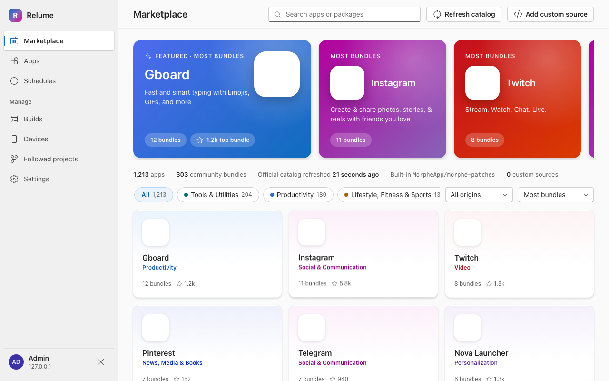

### Phone browser and PWA

The same pages work on a phone. Below 900 px width the sidebar becomes a menu (the ☰ button in the top-left corner), tables turn into cards, and button labels shrink to icons.

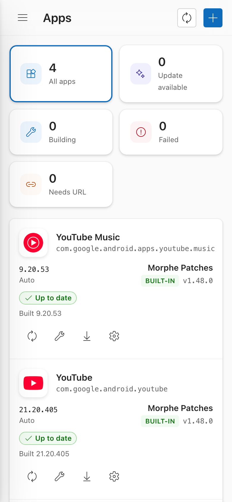 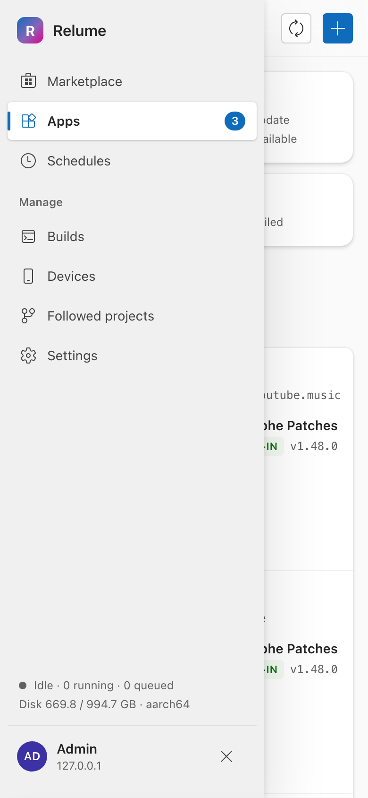

The Web UI ships a manifest (`display: standalone`, Relume icons), so the browser can install it as an app: use "Install app" (Chrome desktop) or "Add to Home Screen" (Android Chrome, iOS Safari). It opens without browser chrome. There is no offline mode: the server must be reachable.

## Sign in

1. First start only: the page shows `Create admin account`. Choose a username (letters, digits, `. _ -`) and a password of at least 10 characters, repeat it in `Confirm password`, then press `Create account`.
2. Every later visit shows `Sign in`. The checkbox `Keep me signed in on this device (30 days)` is on by default.
3. After 5 wrong attempts the page locks for 5 minutes (`Too many attempts. Try again in …`).
4. Forgot the password: set `RELUME_ADMIN_PASSWORD` on the `app` container and restart it (see the deploy section above). This also signs out all browsers.

There is exactly one admin account. Change its password later on the `Settings` page.

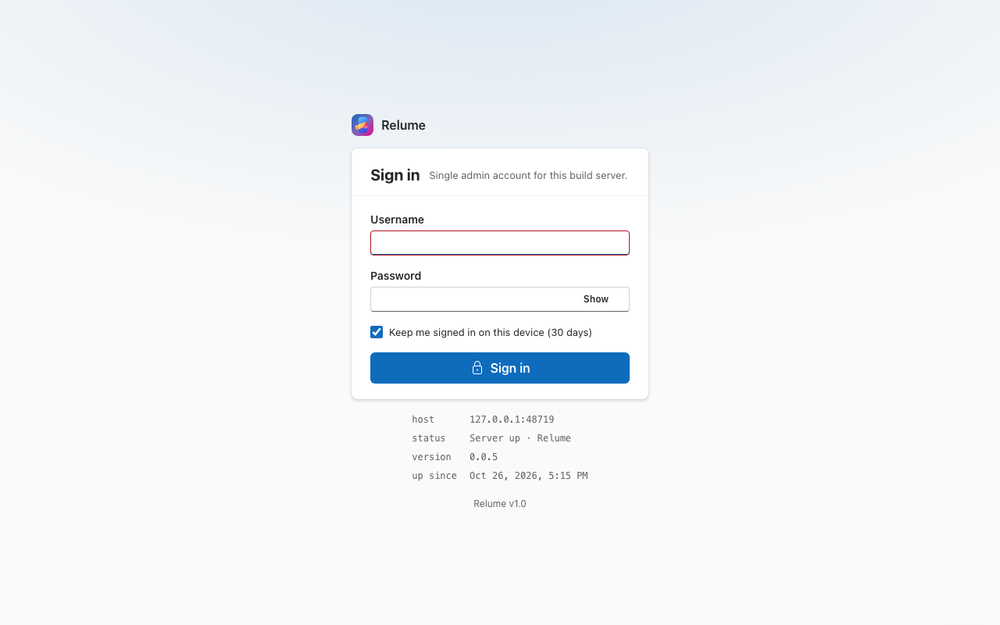

## Marketplace

The Marketplace lists every app Relume can patch, built from three origins (filter `All origins`): `Official catalog` (community feed, refreshed automatically on every schedule run), `Built-in` (the Morphe patches Relume ships with) and `Custom` (sources you add yourself). Cards show the number of bundles and GitHub stars.

- Search box: `Search apps or packages`.
- Category pills and the `Sort` dropdown (`Most bundles`, `Most stars`, `Recently updated`, `Name A–Z`).
- `Refresh catalog`: fetch the community feed now. If the catalog is empty (first start), press it once.
- Click a card to expand its detail panel; click the card again or `Close` to collapse it.

### Enable an app

Enabling an app means "keep this app patched and up to date". It takes three steps in the detail panel:

1. **Choose one patch bundle.** A bundle is a patch set from one author (for example `Morphe Patches`). One bundle per app; you can switch it later in `Apps`. Bundles that do not fit the app are disabled.
2. **Patches in …** Defaults come from the bundle. Switch single patches on or off; use `Filter patches`, `All on` or `Reset to defaults`. Your changes survive new bundle versions (a `Changed by you` / `Default off` tag shows what you touched). Patches with options (for example a custom icon or app name) expand to show them.
3. **Download source.** Relume finds the APKMirror page of the app by itself after you enable it. If the status says `APKMirror page not found` or `Several APKMirror pages match`, paste the listing URL into `APKMirror listing URL` (the page that lists all versions of the app, not one release). `APKPure URL` is an optional fallback.

Press `Enable and build`. The app moves to `Apps` and its first build is queued immediately. The version defaults to `Auto` (the newest version the bundle supports).

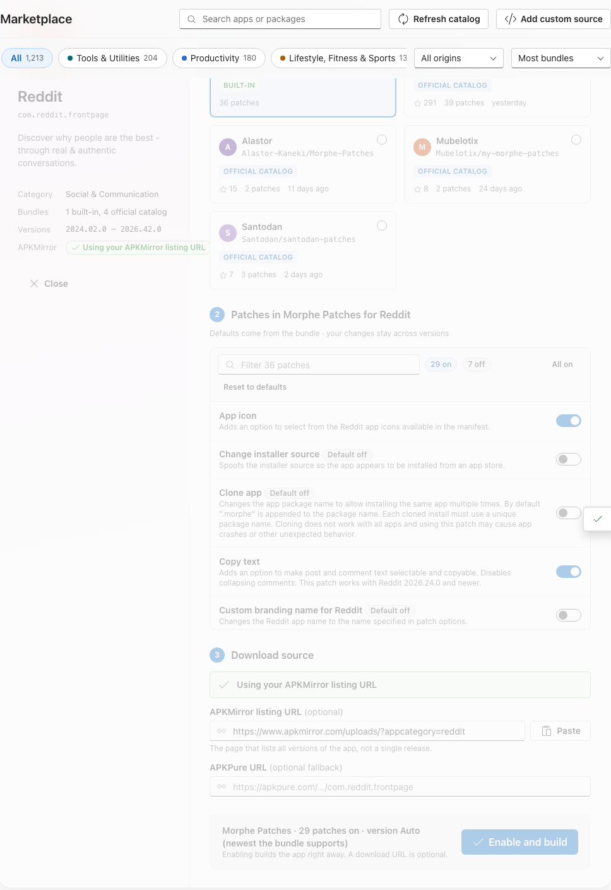

### Add a custom source

`Add custom source` takes a GitHub repository you trust:

1. Enter `GitHub repository URL` (`github.com/owner/repo`).
2. Pick the `Engine`: `Morphe patches`, `Xposed module, packaged with LSPatch` or `Xposed module, packaged with NPatch`.
3. For Xposed modules also fill `Release asset regex` (which release file is the module APK) and `Target packages` (comma separated package names of the apps the module is offered for).
4. Press `Add source`. Its apps appear with a `Custom` label.

Added sources are listed under `Custom sources` at the bottom of the page, each with a delete button. Deleting asks for confirmation.

## Apps

`Apps` lists every enabled app, plus the projects you follow (see `Followed projects`). The five tiles on top filter by status: `All apps`, `Update available`, `Building`, `Failed`, `Needs URL`. The caption in the header shows when the next scheduled run happens.

Per row you see the app version, the bundle (`Source`) and a status badge: `Up to date`, `Update available`, `Building`, `Queued`, `Not built`, `Failed` or `Needs URL`. A failed build shows the reason and a `View log` link.

Row buttons (hover for the tooltip):

| Button | Action |
|---|---|
| Check for updates | Look for a new bundle release or app version for this app. |
| Rebuild / `Retry build` / `Rebuild with update` | Queue a build now. |
| Download APK | Pick the file to download (one entry per ABI variant). |
| App settings | Open the settings drawer. |

Header buttons: `Check all for updates` (runs the whole update check now) and `Add from Marketplace`.

`Needs URL` means Relume could not find the APK download page: open the settings drawer and fill in `Download URLs`.

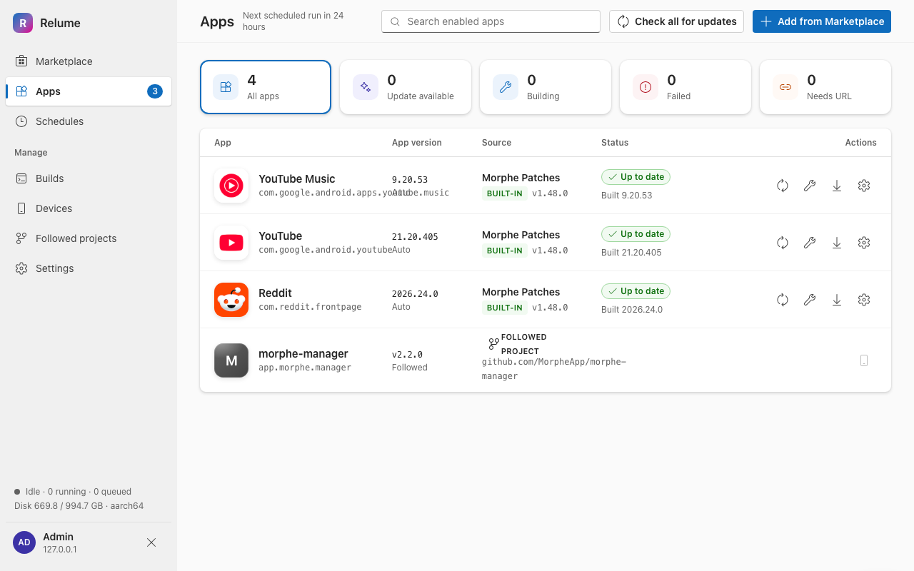

### Change an app's settings

The gear button opens the settings drawer. Edit what you need, then press `Save`, or `Save and rebuild` to save and queue a build. `Cancel` discards the changes.

| Section | What you can do |
|---|---|
| `Enabled` switch (top) | Turn it off to stop updating and building. Settings and past builds are kept (asks for confirmation on save). |
| `Patch bundle` | Switch to another bundle. Patch choices with matching names carry over. |
| `Patches` | Same list as in the Marketplace, with `Filter patches` and `Reset to defaults`. |
| `Xposed module` | Only for LSPatch / NPatch sources: `Signature bypass level` and `Inject loader dex`. |
| `Version` | `Auto` (newest the bundle supports), `Pinned` (stay on one version; choose it in `Pinned version`) or `Latest` (newest on APKMirror, ignores compatibility). `Allow nearest version` builds the closest version if the pinned one is missing on APKMirror. |
| `ABI variants` | Which CPU architectures to build. At least one is required. |
| `Depends on Followed projects` | Tick followed projects that must be installed on the phone alongside the app (for example a companion APK). |
| `Download URLs` | `APKMirror listing` and `APKPure`. When several APKMirror pages match, pick the right one here. |
| `Display name` | Rename the app. `Refresh icon` re-fetches its icon. |

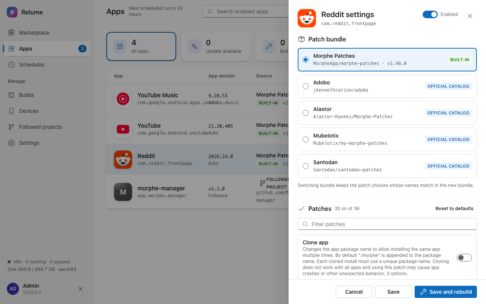

## Builds

The top panel shows the queue and the log of the selected build (live while it runs). `Cancel` stops a running or queued build, the arrow button downloads the log as a file.

Below, `History` lists past runs. Filter with the search box (`Search app or bundle`) and the pills `All`, `Succeeded`, `Failed`, `Cancelled`; `Load older` fetches more. Each row has buttons to view its log, download the APK of a successful build or retry a failed one. Runs of type `Project pull` are checks of followed projects; `Update run` is the scheduled update check.

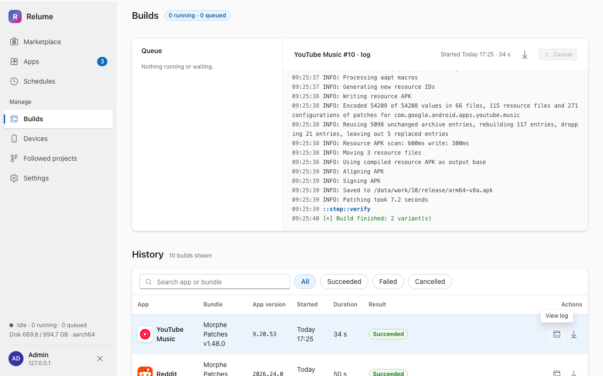

## Schedules

### Update schedule

The big card, `Keep every enabled app updated`, defines when Relume runs its update check. Each run does, in order: `Refresh catalog`, `Check chosen bundles`, `Check APKMirror`, `Rebuild what changed` (only apps with a new bundle or version) and `Notify`.

1. Pick the interval: `1 h`, `3 h`, `6 h`, `12 h`, `24 h` or `Custom`. `Custom` offers `Repeat` = `Hourly`, `Daily` or `Weekly` with the time (`At`) and weekdays (`On days`).
2. Switch `Schedule on`. Optionally switch `Notify on result` (the channel is configured in `Settings`).
3. Press `Save schedule`.

The card shows the next run (in the server's time zone, shown in the header) and the last run with a `View log` link. `Run now` starts a run immediately; follow it on `Builds`.

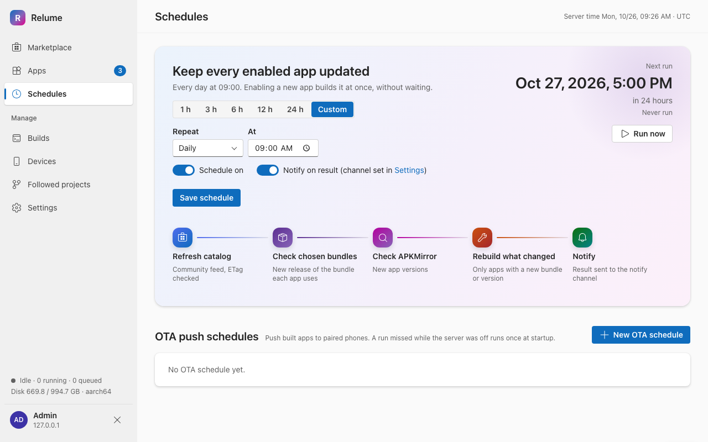

### OTA push schedules

An OTA schedule pushes the latest built apps to paired phones over wireless ADB at set times, without opening the Web UI. Press `New OTA schedule`, give it a `Name`, choose the repeat pattern (same fields as `Custom` above), `Retries for offline phones (60 s apart)` (0 to 5), the `Phones` (`All phones` or specific ones) and whether to `Notify on result`. Each schedule has an on/off switch and buttons to run now, edit and delete. A run missed while the server was off runs once at startup.

## Devices

A phone can be managed two ways: over **wireless ADB** (this page) or through the **Relume companion app** installed on the phone (listed with a `Relume app` badge; manage it from the app, see the Android section). The top of the page shows the network mode: the recommended mode is `host` on Linux/NAS (phones are discovered via mDNS on the local network) and `bridge` on Docker Desktop for macOS, where you enter the phone's IP and ports by hand. When nothing is discovered, use `Manual pairing`.

### Pair a phone over wireless ADB

1. On the phone: Settings → Developer options → turn on `Wireless debugging`, then open `Pair device with pairing code`.
2. In `Discovered on network` the phone appears with a `Pairing mode` badge. Press `Pair`, type the 6-digit code, press `Pair`.
   If it is not discovered, use `Manual pairing`: `Phone IP`, `Pairing port`, the six digits of `Pairing code`, optionally `Connect port (optional)`, then `Pair & connect`.
3. The phone appears under `Paired devices`. Click its name to rename it.

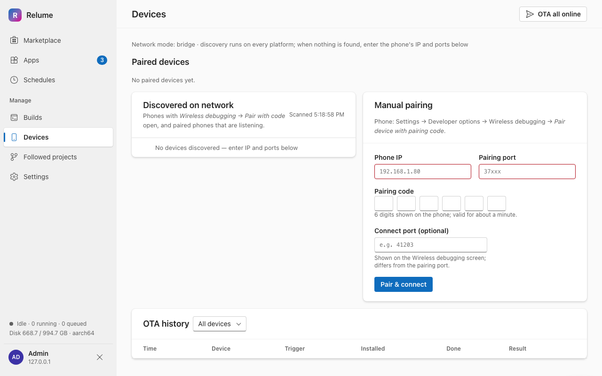

### Install and update apps on a phone

Each paired phone card lists the apps assigned to it with installed and available versions.

1. Press `Edit apps…` and tick the enabled apps (and followed projects) this phone should receive, then `Save`.
2. `OTA now · N pending` installs everything that is out of date on that phone. The header button `OTA all online` does it for all online phones.
3. Switch `Install after build` to install automatically whenever a build finishes.
4. Offline phone: turn on `Wireless debugging` on the phone, then press `Reconnect` (it asks for the new connect port if it changed).
5. If an install fails with a signature mismatch, the page offers `Uninstall & retry` (the app's data is lost); for a version downgrade it offers `Install with downgrade`.
6. `Unpair` removes the phone (on the phone also tap Forget under Wireless debugging).

`OTA history` at the bottom logs every install with time, trigger, installed version and result; filter it by device.

## Followed projects

Follow a GitHub project that publishes finished APKs in its releases (for example a patch manager). Relume downloads new releases, verifies the signing key and can push them to phones. They also appear in `Apps` (as `Followed project`) and can be installed from there.

1. Press `Follow project`.
2. Enter the `GitHub repository URL` (`owner/repo` also works) and press `Fetch release`. Private repositories work if you saved a token in `Settings`.
3. Tick the APK files to follow in `Asset file`. `Asset regex` is derived from your ticks and editable: future releases must match it, otherwise the check reports an error. Relume picks the APK that fits the phone's CPU, else the universal one.
4. Choose the `Channel` (`Stable` or `Pre-release`), an optional `Display name`, `Auto-push` (install new versions on assigned phones right after download; pauses by itself if the signer changes) and the phones to assign.
5. Press `Follow project`.

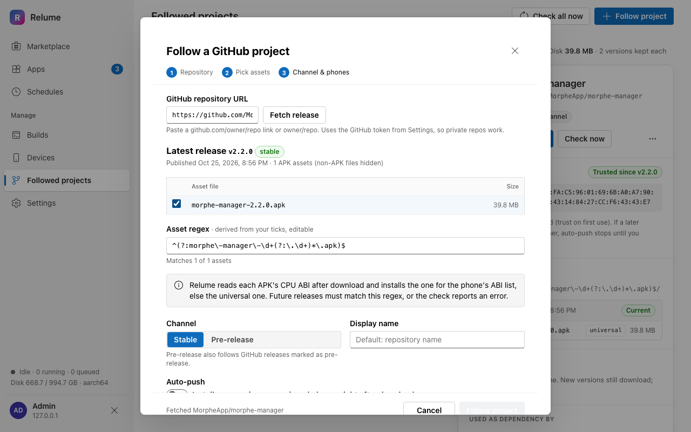

Select a project in the list to open its detail pane: `Install to phone`, `Check now`, signer fingerprint, kept versions (2 per project), assigned phones, OTA history. The `⋯` menu has `Edit assets, regex & channel`, `Assign phones` and `Unfollow` (deletes its downloaded APKs; not possible while an app depends on it). `Check all now` in the header checks every project. Filters: `All`, `Needs attention`, `Dependencies`.

If a release is signed with a different certificate than the first one, it is quarantined: auto-push, scheduled OTA and install stop until you open `Review & confirm signer…` and `Trust new signer`. Android also refuses to update over an app with a different signer, so phones must uninstall the old app first.

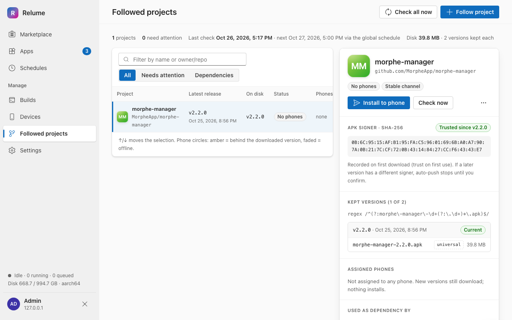

## Settings

- **Notifications.** Switch `Enabled`, pick one channel (`Telegram`: `Bot token` + `Chat ID`; `Discord`: `Webhook URL`; `ntfy`: `Server` + `Topic`), and choose the events under `Notify on`: `New upstream patches`, `Build succeeded`, `Build failed`, `OTA finished`, `Project signer changed`, `Device went offline`. `Send test` checks the channel, `Save` stores it. Secrets are write-only and shown masked.
- **Artifacts.** `Keep per item` (how many APK versions to keep per app), `Job history count`, `Base URL` (the address used in links, for example `http://nas.local:47000`) and the `Disk` usage. `Clean up` deletes builds of apps that are not enabled and unused download cache.
- **GitHub token.** Raises GitHub's API limit from 60 requests per hour and enables private followed repositories. Paste a token and press `Save`; `Remove` deletes it; `Re-check` shows the remaining rate limit. A token saved here takes precedence over the optional mounted secret file. It is never shown again.
- **Phones with the Relume app.** Companion app devices that signed in. Revoking signs that phone out; its row and history stay.
- **Change password.** `Current password`, `New password` (at least 10 characters), `Confirm new password`, then `Update password`.

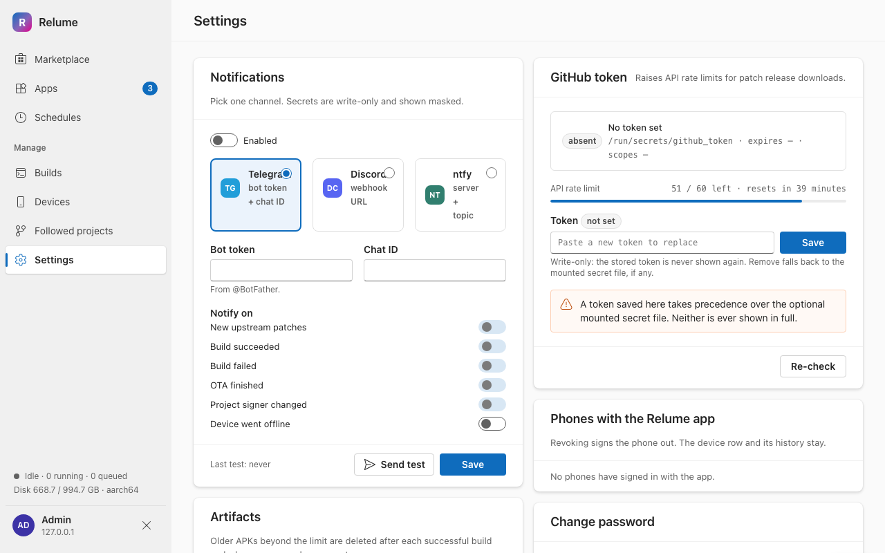

## Android companion app

The companion app (`android/`, Kotlin + Compose) installs the APKs that Relume builds directly on the phone, **without ADB and without root**. It signs in to your Relume server with the admin account, gets a per-device token, downloads the built APKs, verifies their SHA-256 and signer, and hands them to Android's package installer. It also reports which apps the phone has, so Relume can show "Installed" or "Phone has …" per app.

You can enable apps and trigger builds in the web UI or in the app. The app's main job is **Install** and **Update** on this phone.

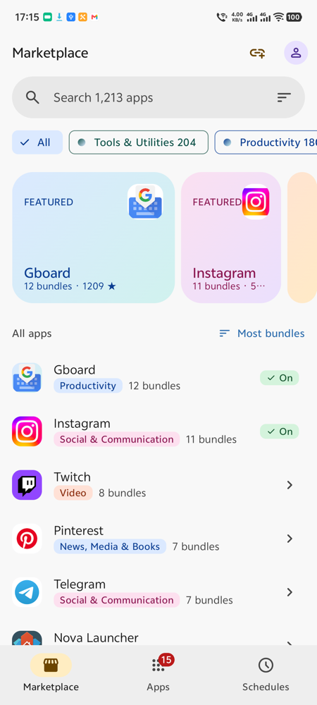
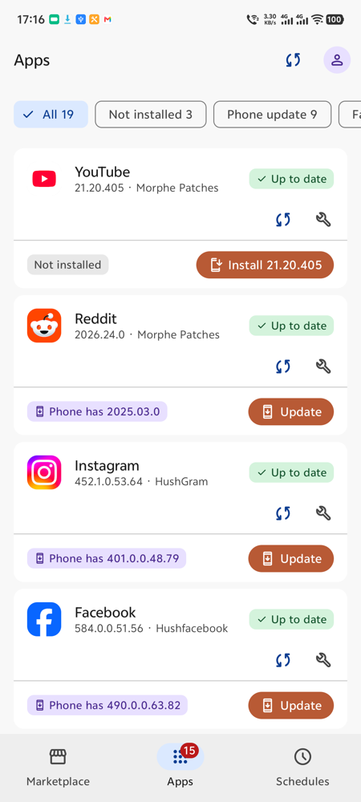
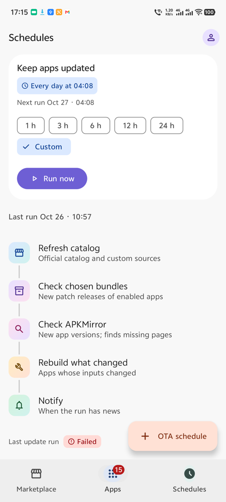

### Get the app

1. Open this repository's GitHub **Releases** page and pick the newest release tagged `companion-vX.Y.Z`.
2. Download `relume-companion.apk` and open it on the phone (the app needs Android 10 / API 29 or newer).
3. If Android asks, allow your browser or file manager to install unknown apps.

CI builds and publishes the app only when a `companion-vX.Y.Z` tag is pushed. The app does not update itself: to update the companion, download the newer `relume-companion.apk` from Releases and install it over the old one. The installed version is shown in Settings under `App version`.

### First start: connect to your server

1. Open Relume. The `Connect to Relume` screen asks for three values:
   - `Server URL`: the address of your Relume Web UI, for example `https://relume.example.com`. `https://` is recommended; it works over Tailscale or a reverse proxy. `http://` is accepted only for private addresses (LAN, localhost); public addresses must use `https://`. The URL must not contain a path, query or user name.
   - `Username` and `Password`: the Relume admin account.
2. Tap `Sign in`. The app checks the server, then registers this phone and stores a per-device token (not your password).
3. If the server already lists this phone as an ADB device, the app asks whether it is that device. Tap the device to keep its app assignments, or `No, register as a new device`.
4. On Android 13 or newer the app asks for the notification permission. Allow it to get install notifications.

The token can be revoked on the server at any time; the app then asks you to sign in again.

### Tabs

The bottom bar has three tabs: `Marketplace`, `Apps` and `Schedules`. The round account button at the top right opens Settings.

#### Apps

The tab you land on after sign-in. Each enabled app is a card with its version and patch bundle, a build status pill and a phone row. The badge on the tab shows how many apps are enabled.

- **Filters**: `All`, `Not installed`, `Phone update`, `Failed`, `Needs URL`, each with a count. Pull down to refresh.
- **Install and update**: the phone row shows `Not installed`, `Installed <version>` or `Phone has <version>`. Tap `Install <version>` or `Update` to start an install run. The `Install` screen shows each app going through `Download`, `Verify sha256 and signer` and `System install`. `Cancel` stops the run, `Done` closes it.
- **Confirmation**: Android asks for one confirmation when an app is installed for the first time or was installed by another installer. Tap `Confirm` on the `Install` screen (or on the notification) and accept the Android dialog. Updates of apps that Relume installed itself normally need no confirmation.
- **Dependencies**: if an app needs another one, a dialog lists them in order. Tap `Install all`.
- **Per-app buttons**: the sync icon checks that app for updates, the wrench icon rebuilds it (`Retry … build` after a failure). `Live log` or `Log` opens the build log. Tapping the card opens the app settings (bundle, patches, version mode, ABI variants, download URLs, `Save` or `Save & rebuild`).
- **Needs URL**: when APKMirror has no unique page for an app, the card shows `Add URL` (paste the APKMirror listing URL, then `Save`) or `Pick one` (choose the right page, then `Use this page`).
- **Followed apps**: apps from Followed projects appear as cards marked `Followed project`, with `Install` or `Update` only.
- The sync icon in the top bar (`Check all apps for updates`) starts the same update run as `Run now` on the Schedules tab.

#### Marketplace

Browse the catalog the server loaded.

1. Search (`Search … apps`), filter with the category chips, or use the sort button (`Most bundles`, `Most stars`, `Recently updated`, `Name A–Z`; `All origins`, `Official catalog`, `Built-in`, `Custom`).
2. Tap an app, then pick one bundle under `Choose one bundle`. Switch individual patches on or off. `Reset` restores the defaults.
3. Tap `Next: download source`. Optionally paste an `APKMirror listing URL (optional)` or `APKPure URL (optional)`.
4. Tap `Enable and build`. Relume builds the app right away and keeps it updated on the global schedule. The app then opens that app's settings on the Apps tab. Apps that are already enabled show `On`.

The link button in the top bar (`Add custom source`) adds a community catalog by `GitHub repository URL`. The lspatch and npatch engines also ask for `Asset regex` and `Target packages (comma separated)`. If the list is empty, tap `Refresh catalog`.

#### Schedules

- `Keep apps updated`: how often the server checks for new patch releases and app versions and rebuilds what changed. Pick `1 h`, `3 h`, `6 h`, `12 h`, `24 h` or `Custom` (hourly, daily or weekly). `Run now` starts a run immediately. Below it you see the steps of a run and the outcome of the last one (`View log`). If the schedule is off, it says so and points to the web Schedules page.
- `OTA push`: timed pushes of new builds to ADB phones. Create one with `OTA schedule`. Phones that install through the companion app cannot be targets; pair ADB phones on the web Devices page.

### Settings

Tap the account button at the top right of a tab.

| Section | What it does |
|---|---|
| `Server` | `Server URL` (saving a new one signs this phone out) and `Connection` with the server version. |
| `Account` | `Sign out and forget token`. Revoke the token itself on the server. |
| `Background` | `Check for new builds`: `Off`, `1 h`, `6 h` or `24 h`. The phone checks in the background and starts installing new builds. `Notifications` shows whether they are allowed (`Allow`). `Last check` shows the last result. |
| `Storage` | `Clean up` deletes builds of apps that are not enabled and unused download cache on the server, after a confirmation dialog. |
| `This device` | The name, model and Android version the server has for this phone. |
| `About` | `App version`. |

Background installs follow the same rules as manual ones. Where Android needs a confirmation you get a notification (`Tap to confirm install of …`), and a summary notification reports how many apps were installed.

### Troubleshooting

| Symptom | What to do |
|---|---|
| `Can't reach <url>` on sign-in, or `Request failed` banners | Check the address and port, that the phone can reach the server (same LAN, Tailscale, or a reverse proxy over `https://`) and that the stack is running. Then tap `Retry`. Settings checks the new `Server URL` against `/api/health` before saving. |
| `Sign-in failed` | Use the Relume admin username and password from the web UI. |
| `use https:// for public addresses` | `http://` works only for private hosts. Put a TLS reverse proxy in front, or use a private address. |
| `Allow installs from Relume` dialog | Android blocks installs until you allow Relume under "Install unknown apps". Tap `Open settings`, enable it, return to Relume and start the install again. |
| `Signature doesn't match` or `A newer version is installed` | The app on the phone is signed differently or newer than the build, so Android cannot update it in place. Use `Uninstall and install…` and tick `I understand, uninstall first`. **This deletes the app's data on the phone.** |
| `Signing key changed` | The signing key of an app changed on the server. Tap `Accept key` only if you expected that. |
| An install waits at `Needs your confirmation` | Tap `Confirm`, then accept the Android system dialog. |
| `The plan changed on the server` | Nothing was installed. Go back, tap `Refresh` and start again. |
| Patched YouTube, YouTube Music or Google Photos | These apps need [MicroG RE](https://github.com/MorpheApp/MicroG-RE) installed on the phone. |

## Development

- Tests: `python3 scripts/test.py [--legs python,shell,android]` (macOS and Linux only). Linux gate (the server's real platform):

  ```sh
  docker build -f local/Dockerfile --target app -t relume-gate . && docker run --rm -v "$PWD:/repo" -w /repo relume-gate env -u RELUME_VERSION python3 scripts/test.py --legs python,shell
  ```

  Android leg (needs the Android SDK): `ANDROID_HOME=<sdk> python3 scripts/test.py --legs android`.
- The companion app is released by pushing a tag `companion-vX.Y.Z`: the `Android` workflow builds and publishes `relume-companion.apk` as a GitHub release of this repo.
- Images are published to Docker Hub with `python3 scripts/release.py <version>`.
- More: common questions are answered in [docs/Frequently Asked Questions.md](docs/Frequently%20Asked%20Questions.md).

## License

GPL-3.0, see [LICENSE](LICENSE). The patched apps belong to their original authors; please support them.

Relume builds on [FiorenMas/Revanced-And-Revanced-Extended-Non-Root](https://github.com/FiorenMas/Revanced-And-Revanced-Extended-Non-Root).

---

### ⚠️ Library, resources using in this repository:

<details>
  <summary>inotia00</summary>

[Patches](https://github.com/inotia00/revanced-patches) - [GPL-3.0](https://github.com/inotia00/revanced-patches/blob/revanced-extended/LICENSE)

[X Shim](https://gitlab.com/inotia00/x-shim) - [GPL-3.0](https://gitlab.com/inotia00/x-shim/-/blob/main/LICENSE)

[Patches arsclib](https://github.com/inotia00/revanced-patches-arsclib) - [GPL-3.0](https://github.com/inotia00/revanced-patches-arsclib/blob/arsclib-old/LICENSE)

[Integrations](https://github.com/inotia00/revanced-integrations) - [GPL-3.0](https://github.com/inotia00/revanced-integrations/blob/main/LICENSE)

[CLI](https://github.com/inotia00/revanced-cli) - [GPL-3.0](https://github.com/inotia00/revanced-cli/blob/main/LICENSE)

[CLI arsclib](https://github.com/inotia00/revanced-cli-arsclib) - [GPL-3.0](https://github.com/inotia00/revanced-cli-arsclib/blob/arsclib-old/LICENSE)

</details>

<details>
  <summary>anddea</summary>

[Patches](https://github.com/anddea/revanced-patches) - [GPL-3.0](https://github.com/anddea/revanced-patches/blob/main/LICENSE)

[Integrations](https://github.com/anddea/revanced-integrations) - [GPL-3.0](https://github.com/anddea/revanced-integrations/blob/main/LICENSE)

</details>

<details>
  <summary>Morphe</summary>

[Patches](https://github.com/MorpheApp/morphe-patches) - [GPL-3.0](https://github.com/MorpheApp/morphe-patches/blob/main/LICENSE)

[CLI](https://github.com/MorpheApp/morphe-cli) - [GPL-3.0](https://github.com/MorpheApp/morphe-cli/blob/main/LICENSE)

</details>

<details>
  <summary>crimera</summary>

[Patches](https://github.com/crimera/piko) - [GPL-3.0](https://github.com/crimera/piko/blob/main/LICENSE)

[Integrations](https://github.com/crimera/revanced-integrations) - [GPL-3.0](https://github.com/crimera/revanced-integrations/blob/main/LICENSE)

</details>

<details>
  <summary>kitadai31</summary>

[Patches](https://github.com/kitadai31/revanced-patches-android6-7) - [GPL-3.0](https://github.com/kitadai31/revanced-patches-android6-7/blob/revanced-extended/LICENSE)

[Integrations](https://github.com/kitadai31/revanced-integrations) - [GPL-3.0](https://github.com/kitadai31/revanced-integrations/blob/revanced-extended/LICENSE)

</details>

<details>
  <summary>d4n3436</summary>

[Patches](https://github.com/d4n3436/revanced-patches-android5) - [GPL-3.0](https://github.com/d4n3436/revanced-patches-android5/blob/revanced-extended/LICENSE)

[Integrations](https://github.com/d4n3436/revanced-integrations) - [GPL-3.0](https://github.com/d4n3436/revanced-integrations/blob/revanced-extended/LICENSE)

</details>

<details>
  <summary>BiliRoamingM</summary>

[Patches & Integrations](https://github.com/sakarie9/BiliRoamingM) - [GPL-3.0](https://github.com/sakarie9/BiliRoamingM/blob/main/LICENSE)

</details>

<details>
  <summary>indrastorms</summary>

[Patches](https://github.com/indrastorms/Dropped-Patches) - [GPL-3.0](https://github.com/indrastorms/Dropped-Patches/blob/main/LICENSE)

</details>

<details>
  <summary>Aunali321</summary>

[Patches](https://github.com/Aunali321/ReVancedExperiments) - [GPL-3.0](https://github.com/Aunali321/ReVancedExperiments/blob/main/LICENSE)

</details>

<details>
  <summary>scrazzz</summary>

[Patches](https://github.com/scrazzz/my-revanced-patches) - [GPL-3.0](https://github.com/scrazzz/my-revanced-patches/blob/main/LICENSE)

</details>

<details>
  <summary>RookieEnough</summary>

[Patches](https://github.com/RookieEnough/De-ReVanced) - [GPL-3.0](https://github.com/RookieEnough/De-ReVanced/blob/main/LICENSE)

</details>

<details>
  <summary>Paresh Maheshwari</summary>

[Patches](https://gitlab.com/Paresh-Maheshwari/paresh-patches) - [GPL-3.0](https://gitlab.com/Paresh-Maheshwari/paresh-patches/-/blob/main/LICENSE?ref_type=heads)

</details>

<details>
  <summary>gnadgnaoh</summary>

[Patches](https://github.com/gnadgnaoh/NexAlloy) - [GPL-3.0](https://github.com/gnadgnaoh/NexAlloy/blob/main/LICENSE)

</details>

<details>
  <summary>icysymmetra</summary>

[Patches](https://github.com/icysymmetra/tiktok-patches-for-morphe) - [GPL-3.0](https://github.com/icysymmetra/tiktok-patches-for-morphe/blob/main/LICENSE)

</details>

<details>
  <summary>docbt</summary>

[Patches](https://github.com/docbt/patched-up) - [GPL-3.0](https://github.com/docbt/patched-up/blob/main/LICENSE)

</details>

<details>
  <summary>rushiranpise</summary>

[Patches](https://github.com/rushiranpise/morphe-patches) - [GPL-3.0](https://github.com/rushiranpise/morphe-patches/blob/main/LICENSE)

</details>

<details>
  <summary>arandomhooman</summary>

[Patches](https://github.com/arandomhooman/hoomans-morphe-patches) - [GPL-3.0](https://github.com/arandomhooman/hoomans-morphe-patches/blob/main/LICENSE)

</details>

<details>
  <summary>bufferk</summary>

[Patches](https://github.com/bufferk/morphe-patches) - [GPL-3.0](https://github.com/bufferk/morphe-patches/blob/main/LICENSE)

</details>

<details>
  <summary>Revanced</summary>

[CLI](https://github.com/revanced/revanced-cli) - [GPL-3.0](https://github.com/revanced/revanced-cli/blob/main/LICENSE)

</details>

[AuroraStore](https://gitlab.com/AuroraOSS/AuroraStore) - [GPL-3.0](https://gitlab.com/AuroraOSS/AuroraStore/-/blob/master/LICENSE)


[pup](https://github.com/ericchiang/pup) - [MIT](https://github.com/ericchiang/pup/blob/master/LICENSE)

[APKEditor](https://github.com/REAndroid/APKEditor) - [Apache-2.0](https://github.com/REAndroid/APKEditor/blob/master/LICENSE)

[FlareSolverr](https://github.com/FlareSolverr/FlareSolverr) - [MIT](https://github.com/FlareSolverr/FlareSolverr/blob/master/LICENSE)


---
