<h1 align="center">Relume</h1>
<p align="center">以 ReVanced、ReVanced Extended、Morphe 等修補集，自動化、免 root 地修補 Android 應用程式。</p>
<p align="center"><a href="README.md">English</a> · 繁體中文</p>

> "…that Promethean heat that can thy light relume." — Othello。Relume 讓官方應用程式重新發光：下載官方 APK、套用社群修補，再把修補後的 APK 交還給你。

---

## Relume 是什麼

Relume 是可自行架設的 Web UI（Docker），讓你**免 root** 取得熱門 Android 應用程式（YouTube、YouTube Music、Google Photos 等）的修補版。它會下載你啟用的每個應用程式的官方 APK，套用你選的修補組合（ReVanced、ReVanced Extended、Morphe、LSPatch、NPatch 等），簽署後備妥待安裝。當應用程式或修補推出新版本，下一次排程建置會自動更新。

> [!NOTE]
> YouTube、YouTube Music 或 Google Photos 需要在手機上安裝 [MicroG RE](https://github.com/MorpheApp/MicroG-RE)。
>
> Beta 建置使用的是開發中的修補，不是 beta 版 APK。它與穩定版使用相同的套件名稱，因此安裝其中一個會覆蓋另一個。

## 使用情境

- 想在不 root 的手機上使用修補版應用程式，又不想自己找 APK、手動修補。
- 有家用伺服器或 NAS，希望上游一發佈新版本，就在同一處自動重建修補版應用程式。
- 管理多支手機（家人、測試機），想在每支手機上安裝或更新相同的建置。
- 想嘗試社群修補集（新增社群目錄或自訂來源），但不想自己架設每一套修補工具鏈。

## 運作方式

1. **Marketplace**：瀏覽內建目錄、社群目錄與自訂來源，啟用應用程式（選擇其 bundle、修補與版本）。
2. **排程建置**：所有已啟用的應用程式依同一個全域排程重建（也可隨時手動觸發）。Relume 下載官方 APK、修補並簽署。
3. **安裝到手機**：使用 Relume 伴侶應用程式（直接在手機上安裝，不需要 ADB），或從 Web UI 使用無線 ADB。

## 以 Docker 部署

整個堆疊有五個容器：Web UI 與建置器（`app`），加上 FlareSolverr、Cloudflare 繞過瀏覽器（`cfbypass`）與 APKMirror 解題器（`apkmsolver`）三個輔助容器，全部共用同一個網路命名空間（`netns`）。Web UI 監聽 47000 埠。

> [!NOTE]
> 已發佈的映像檔 `jhangyu/relume-app` 與 `jhangyu/relume-browser` 僅支援 `linux/arm64`（`scripts/release.py` 會拒絕其他平台）。

### 需要了解的設定

| 變數 | 說明 |
|---|---|
| `RELUME_DATA_DIR` | 主機上的目錄，存放所有能從空資料夾重新產生的內容：資料庫、記錄、產出檔、快取、上游下載、工作檔。可安全刪除（但會失去存在資料庫中的歷史與設定）。 |
| `RELUME_KEY_DIR` | 主機上的目錄，存放必須保留的內容：adb 金鑰，以及在 Settings 頁輸入的 GitHub token。**請備份，切勿刪除**：沒有它，每支已配對的手機都必須重新授權。此目錄必須事先存在，Compose 不會建立。 |
| `RELUME_KEYSTORE_DIR` | 僅 Portainer 堆疊使用。主機上存放 `fiorenmas.ks`、`lspatch-signing.p12` 與 `morphe.keystore` 的目錄（只會掛載這三個檔案）。這些檔案已隨儲存庫提供於 [`src/keystore/`](src/keystore)。 |
| `RELUME_NETWORK_MODE` | Linux 主機與 NAS 用 `host`（以 mDNS 探索手機）；Docker Desktop（macOS/Windows）用 `bridge`（以 IP:埠號手動新增手機）。 |
| `RELUME_WEB_PORT` | `bridge` 模式下對外發佈的 Web 埠（預設 `47000`）。host 模式固定使用 47000。 |
| `RELUME_UID`、`RELUME_GID` | 伺服器行程以及資料／金鑰目錄的擁有者。Linux：填你的 uid 與 gid（`id -u`、`id -g`）。Docker Desktop（macOS）：維持 `0`／留空。 |
| `TZ` | 時區（預設 `UTC`）。 |

在 Linux 上，`RELUME_DATA_DIR` 與 `RELUME_KEY_DIR` 必須由 `RELUME_UID:RELUME_GID` 擁有。使用 Portainer 堆疊時，請先自行建立 `RELUME_DATA_DIR` 及其子目錄 `work`、`apk-cache`、`upstream`（否則 Compose 會建成 root 擁有），並讓 `work` 與 `apk-cache` 可被建置執行者（uid 10001，相同 gid）寫入：`chmod 0770`，群組為 `RELUME_GID`。細節見 [`local/docker-compose-portainer.yml`](local/docker-compose-portainer.yml) 開頭的說明。

### 方案 A：Portainer 堆疊（建議）

使用已發佈的映像檔，不需自行建置。

1. 取得 keystore：把本儲存庫 clone（或下載 `src/keystore/`）到主機上，記下路徑。
2. 先建立一次金鑰目錄：`mkdir -p /path/to/relume-key`。
3. 在 Portainer：**Stacks > Add stack > Web editor**，貼上堆疊 YAML（複製 [`local/docker-compose-portainer.yml`](local/docker-compose-portainer.yml)，或使用下方的參考 YAML）。
4. 在 **Environment variables** 設定 `RELUME_DATA_DIR`、`RELUME_KEY_DIR`、`RELUME_KEYSTORE_DIR`（皆為絕對路徑），並視需要設定 `RELUME_NETWORK_MODE`、`RELUME_UID`、`RELUME_GID`、`TZ`：可用「Load variables from .env file」載入下方的參考環境變數（請先修改路徑），或貼到進階文字模式。[`local/portainer.env`](local/portainer.env) 是類似的範本。
5. 部署堆疊，然後開啟 `http://<伺服器 IP>:47000`。
6. 發佈新版本後，在堆疊上使用 **Pull and redeploy**。

可直接複製到 Portainer 的參考檔案：把 YAML 貼到 Web editor，用「Load variables from .env file」載入環境變數（或貼進 Environment variables），然後 **Deploy the stack**。

<details><summary>參考堆疊 YAML（<code>local/docker-compose-portainer.yml</code>）</summary>

```yaml
# Relume as a Portainer stack (Stacks > Add stack > Web editor: paste this file). Same services and isolation as
# local/docker-compose.yml, but the code is in the images, data lives in host directories
# (RELUME_DATA_DIR regrowable data, RELUME_KEY_DIR the keys; bind mounts), the keystores are mounted, and the GitHub token is entered on the Settings page.
#
# Environment variables (Portainer "Environment variables" form):
#   RELUME_DATA_DIR      required: absolute host directory for everything that regrows from an empty folder (database, logs, artifacts, APK outputs and caches, upstream downloads, work); Compose creates it and the subdirectories work, apk-cache and upstream if missing, so deleting it is safe
#   RELUME_KEY_DIR       required: absolute host directory for what must survive (the adb key under .android/ and the GitHub token entered on the Settings page); must exist, Compose does not create it. Back it up, never delete it: deleting it re-authorizes every paired phone
#   RELUME_KEYSTORE_DIR  required: host directory holding fiorenmas.ks, lspatch-signing.p12 and morphe.keystore; only these three files are mounted (never inside an image)
#   RELUME_NETWORK_MODE  host (default; Linux hosts, mDNS phone discovery) or bridge (Docker Desktop on macOS/Windows:
#                    host networking is not available there; add phones by IP:port)
#   RELUME_WEB_PORT      published web port in bridge mode (default 47000; host mode always uses 47000)
#   RELUME_UID, RELUME_GID   server uid:gid in the container (default 0:0). Docker Desktop (macOS): bind mounts need no chown, keep 0.
#                    Linux host: RELUME_DATA_DIR and RELUME_KEY_DIR must be owned by RELUME_UID:RELUME_GID (chown -R; create RELUME_DATA_DIR and its work, apk-cache, upstream yourself first, otherwise Compose makes them root-owned), and work and apk-cache must be
#                    writable by the build runner (uid 10001, same gid as the server): chmod 0770, group RELUME_GID
#   TZ               default UTC
#
# Images: jhangyu/relume-app and jhangyu/relume-browser (linux/arm64) from Docker Hub, published by `python3 scripts/release.py`.
# After a release use "Pull and redeploy" on the stack.
services:
  netns:
    container_name: relume-netns
    image: busybox:1.38.0-musl
    command: ["tail", "-f", "/dev/null"]
    network_mode: ${RELUME_NETWORK_MODE:-host}
    ports: ["${RELUME_WEB_PORT:-47000}:47000"]
    restart: unless-stopped
  flaresolverr:
    container_name: relume-flaresolverr
    image: ghcr.io/flaresolverr/flaresolverr:v3.5.2
    network_mode: service:netns
    depends_on: [netns]
    environment:
      HOST: "127.0.0.1"
      PORT: "47191"
    restart: unless-stopped
  cfbypass:
    container_name: relume-cfbypass
    image: jhangyu/relume-browser:latest
    command: ["/app/docker-entrypoint.sh", "--host", "127.0.0.1", "--port", "47800"]
    shm_size: 2g
    network_mode: service:netns
    depends_on: [netns]
    restart: unless-stopped
  apkmsolver:
    container_name: relume-apkmsolver
    image: jhangyu/relume-browser:latest
    entrypoint: ["sh", "/solver/xrun.sh"]
    command: ["/app/venv/bin/python3", "-u", "/solver/solver.py", "47900"]
    shm_size: 2g
    network_mode: service:netns
    depends_on: [netns, cfbypass]
    restart: unless-stopped
  app:
    container_name: relume-app
    image: jhangyu/relume-app:latest
    network_mode: service:netns
    depends_on: [netns, flaresolverr, cfbypass, apkmsolver]
    init: true  # reaps orphaned grandchildren of killed jobs (PID 1 is python3 -m webui)
    # Spec build §4 step 4, as in local/docker-compose.yml: build children run as RELUME_RUNNER_UID without capabilities; the
    # server starts as root only so setpriv can drop it to RELUME_UID:RELUME_GID with setuid/setgid/kill/dac_override.
    user: "0:0"
    command: ["setpriv", "--reuid=${RELUME_UID:-0}", "--regid=${RELUME_GID:-0}", "--clear-groups",
              "--inh-caps=+setuid,+setgid,+kill,+dac_override", "--ambient-caps=+setuid,+setgid,+kill,+dac_override",
              "python3", "-m", "webui"]
    environment:
      HOME: /private/key
      RELUME_KEY: /private/key
      # RELUME_ADMIN_PASSWORD: <at least 10 characters>   # uncomment, restart, then remove again: sets the admin password at boot and signs out all browser sessions
      RELUME_DATA: /private/data
      RELUME_RUNNER_UID: "10001"
      RELUME_RUNNER_DATA: /data
      ADB_SERVER_SOCKET: localfilesystem:/private/adb.sock
      TZ: ${TZ:-UTC}
      RELUME_NETWORK_MODE: ${RELUME_NETWORK_MODE:-host}
      PYTHONDONTWRITEBYTECODE: "1"
      PYTHONPATH: /repo/local
      FLARESOLVERR_URL: http://127.0.0.1:47191
      CFBYPASS_URL: http://127.0.0.1:47800
      APKM_SOLVER_URL: http://127.0.0.1:47900
    volumes:
      # Root-only 0700 tmpfs: what the runner uid must not reach (database, HOME with the adb key, adb socket)
      - type: tmpfs
        target: /private
        tmpfs:
          mode: 0o700
      - type: tmpfs
        target: /run/secrets
        tmpfs:
          mode: 0o700
      # DATA regrows from an empty or missing directory: Compose creates the host paths of the data mounts (root-owned; Linux: see the header)
      - type: bind
        source: ${RELUME_DATA_DIR:?set RELUME_DATA_DIR to the host data directory}
        target: /private/data
        bind:
          create_host_path: true
      # what must survive deleting RELUME_DATA_DIR (create_host_path: false, so a missing key dir fails loudly instead of starting without the adb key): the adb key (HOME/.android) and the GitHub token; inside the root-only /private, so the runner uid cannot reach it
      - type: bind
        source: ${RELUME_KEY_DIR:?set RELUME_KEY_DIR to the host key directory}
        target: /private/key
        bind:
          create_host_path: false
      # signing keystores (fiorenmas.ks, lspatch-signing.p12, morphe.keystore) are not in the image: three read-only file mounts from a host directory (other files there, e.g. a github_token, stay invisible to build children)
      - ${RELUME_KEYSTORE_DIR:?set RELUME_KEYSTORE_DIR to the host directory with the signing keystores}/fiorenmas.ks:/repo/src/keystore/fiorenmas.ks:ro
      - ${RELUME_KEYSTORE_DIR:?set RELUME_KEYSTORE_DIR to the host directory with the signing keystores}/lspatch-signing.p12:/repo/src/keystore/lspatch-signing.p12:ro
      - ${RELUME_KEYSTORE_DIR:?set RELUME_KEYSTORE_DIR to the host directory with the signing keystores}/morphe.keystore:/repo/src/keystore/morphe.keystore:ro
      # the runner's view of DATA (RELUME_RUNNER_DATA): only these three subdirectories
      - type: bind
        source: ${RELUME_DATA_DIR:?set RELUME_DATA_DIR to the host data directory}/work
        target: /data/work
        bind:
          create_host_path: true
      - type: bind
        source: ${RELUME_DATA_DIR:?set RELUME_DATA_DIR to the host data directory}/apk-cache
        target: /data/apk-cache
        bind:
          create_host_path: true
      - type: bind
        source: ${RELUME_DATA_DIR:?set RELUME_DATA_DIR to the host data directory}/upstream
        target: /data/upstream
        read_only: true
        bind:
          create_host_path: true
    working_dir: /repo
    healthcheck:
      test: ["CMD", "curl", "-sf", "http://127.0.0.1:47000/api/health"]
      interval: 30s
      timeout: 5s
      retries: 3
    restart: unless-stopped
```

</details>

<details><summary>參考環境變數（以下皆為範例值：請換成你自己的路徑、UID/GID 與 TZ）</summary>

```dotenv
# 必填：主機上的絕對路徑，存放所有能從空資料夾重新產生的內容（資料庫、記錄、產出檔、快取）；可安全刪除
RELUME_DATA_DIR=/srv/relume/data
# 必填：主機上的絕對路徑，存放必須保留的內容（adb 金鑰、GitHub token）；必須事先存在，請備份
RELUME_KEY_DIR=/srv/relume/key
# 必填：主機上存放 fiorenmas.ks、lspatch-signing.p12 與 morphe.keystore 的目錄（例如本儲存庫 src/keystore/ 的複本）
RELUME_KEYSTORE_DIR=/srv/relume/keystore
# Linux 主機或 NAS 用 host（以 mDNS 探索手機），Docker Desktop（macOS/Windows）用 bridge（以 IP:埠號新增手機）
RELUME_NETWORK_MODE=host
# 對外發佈的 Web 埠，僅 bridge 模式有效（host 模式固定 47000）
RELUME_WEB_PORT=47000
# 容器內伺服器的 uid:gid。Linux：填你自己的 id（id -u、id -g），並把資料與金鑰目錄 chown 給它們。Docker Desktop（macOS）：維持 0
RELUME_UID=1000
RELUME_GID=1000
# 時區（預設 UTC）
TZ=UTC
```

</details>

### 方案 B：以 Docker Compose 本機建置

```sh
cp local/.env.example local/.env        # set RELUME_NETWORK_MODE (host on Linux, bridge on macOS); on Linux also RELUME_UID and RELUME_GID
mkdir -p local/key local/data/work local/data/apk-cache local/data/upstream
docker compose -f local/docker-compose.yml up -d --build
```

開啟 `http://localhost:47000`（bridge 模式下埠號為 `RELUME_WEB_PORT`）。映像檔由 [`local/Dockerfile`](local/Dockerfile) 建置，compose 專案名稱為 `relume-dev`。所有設定列於 [`local/.env.example`](local/.env.example)（`RELUME_DATA_DIR` 預設 `./data`、`RELUME_KEY_DIR` 預設 `./key`，皆相對於 `local/`）。也可用 `RELUME_GITHUB_TOKEN_FILE` 指向 GitHub token 檔；token 同樣能在 Settings 頁輸入。

### 首次啟動與管理員密碼

1. 開啟 Web UI。第一次進入會出現設定頁：建立管理員帳號（使用者名稱＋密碼）。
2. **忘記密碼？** 在 `app` 服務的環境變數設定 `RELUME_ADMIN_PASSWORD`（至少 10 個字元；兩個 compose 檔中都已有這一行，預設為註解），然後重新啟動容器。開機時管理員密碼會變成該值，所有瀏覽器登入階段都會被登出；手機的裝置 token 仍然有效。之後請移除該變數。在管理員帳號建立之前，它不會有任何作用。

### 該備份什麼

請備份 `RELUME_KEY_DIR`。`RELUME_DATA_DIR` 可重新產生，因此備份是選用的（其中的資料庫存有你啟用的應用程式、排程與帳號）。

## Web UI 總覽

Web UI 是操作 Relume 的地方。用瀏覽器開啟伺服器的位址與連接埠即可（例如 `http://nas.local:47000`）。除了登入頁，所有頁面都需要管理員帳號。

左側側邊欄依常用順序列出各頁面：

| 頁面 | 用途 |
|---|---|
| `Marketplace` | 瀏覽應用程式與修補套件（patch bundle），啟用應用程式。 |
| `Apps` | 所有已啟用的應用程式：狀態、重新建置、下載、設定。 |
| `Schedules` | Relume 何時檢查更新、何時推送到手機。 |
| `Builds` | 即時佇列、建置記錄與歷史。 |
| `Devices` | 配對手機，在手機上安裝與更新應用程式。 |
| `Followed projects` | 追蹤直接發佈成品 APK 的 GitHub 專案。 |
| `Settings` | 通知、GitHub token、磁碟用量、密碼。 |

側邊欄底部顯示工作程序狀態（閒置或執行中、佇列長度）與磁碟用量，另有 `Sign out` 按鈕。

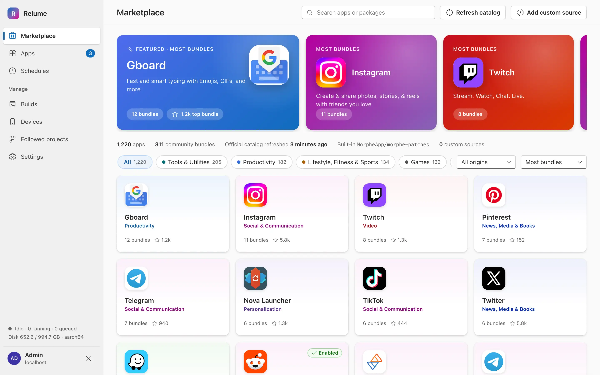

### 手機瀏覽器與 PWA

手機上也能使用同樣的頁面。寬度低於 900 px 時，側邊欄變成選單（左上角的 ☰ 按鈕），表格改為卡片，按鈕文字縮成圖示。

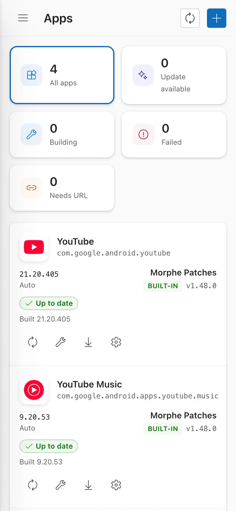 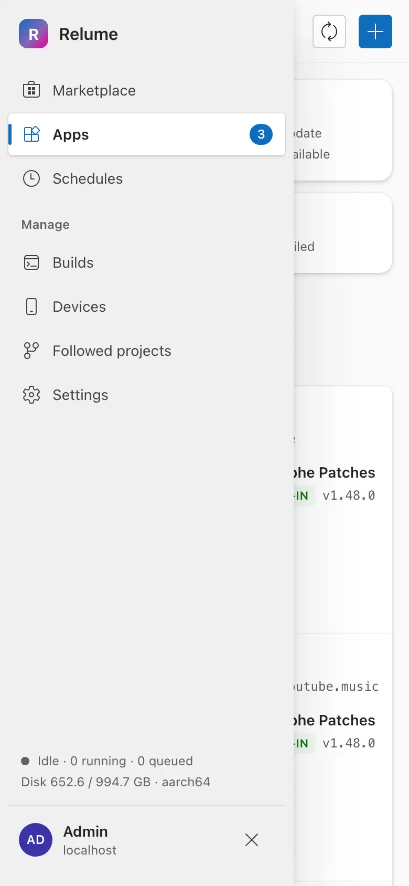

Web UI 附有 manifest（`display: standalone`、Relume 圖示），瀏覽器可以把它安裝成應用程式：桌面 Chrome 用「安裝應用程式」，Android Chrome 或 iOS Safari 用「加入主畫面」。開啟時不顯示瀏覽器外框。沒有離線模式，伺服器必須連得上。

## 登入

1. 僅第一次啟動：頁面顯示 `Create admin account`。設定使用者名稱（英數字與 `. _ -`）與至少 10 個字元的密碼，在 `Confirm password` 再輸入一次，按 `Create account`。
2. 之後每次都顯示 `Sign in`。勾選 `Keep me signed in on this device (30 days)` 預設是開啟的。
3. 連續輸錯 5 次會鎖定 5 分鐘（`Too many attempts. Try again in …`）。
4. 忘記密碼：在 `app` 容器設定 `RELUME_ADMIN_PASSWORD` 後重新啟動（見上方部署章節）。這也會登出所有瀏覽器。

只有一個管理員帳號。之後可在 `Settings` 頁面修改密碼。

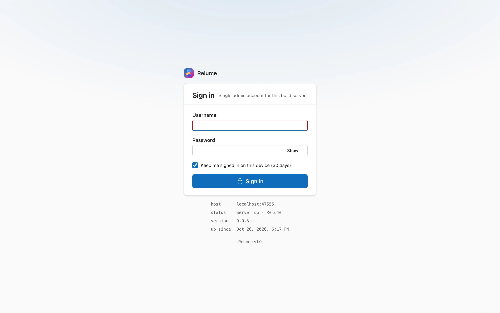

## Marketplace

Marketplace 列出 Relume 能修補的所有應用程式，來源有三種（用 `All origins` 篩選）：`Official catalog`（社群資料來源，每次排程執行時自動更新）、`Built-in`（Relume 內建的 Morphe 修補）、`Custom`（你自己新增的來源）。卡片顯示套件數量與 GitHub 星數。

- 搜尋框：`Search apps or packages`。
- 分類標籤與 `Sort` 下拉選單（`Most bundles`、`Most stars`、`Recently updated`、`Name A–Z`）。
- `Refresh catalog`：立即抓取社群資料。第一次啟動時目錄是空的，按一次即可。
- 點選卡片展開詳細面板；再點一次卡片或按 `Close` 收合。

### 啟用應用程式

啟用應用程式代表「讓這個應用程式持續修補並保持最新」。在詳細面板中分三步：

1. **Choose one patch bundle。** 一個套件（bundle）是某位作者的一組修補。每個應用程式只能選一個套件，之後可在 `Apps` 更換。不適用於該應用程式的套件會呈現停用狀態。
2. **Patches in …** 預設值來自套件。可逐一開關修補項目，也可用 `Filter patches`、`All on` 或 `Reset to defaults`。你的修改會保留到新版套件（`Changed by you` / `Default off` 標籤會標出你改過的項目）。有選項的修補（例如自訂圖示或應用程式名稱）可展開設定。
3. **Download source。** 啟用後 Relume 會自己尋找該應用程式的 APKMirror 頁面。若狀態顯示 `APKMirror page not found` 或 `Several APKMirror pages match`，請把清單網址貼到 `APKMirror listing URL`（列出該應用程式所有版本的頁面，不是單一版本頁）。`APKPure URL` 是選填的備援來源。

按 `Enable and build`。應用程式會移到 `Apps`，第一次建置立刻排入佇列。版本預設為 `Auto`（套件支援的最新版本）。

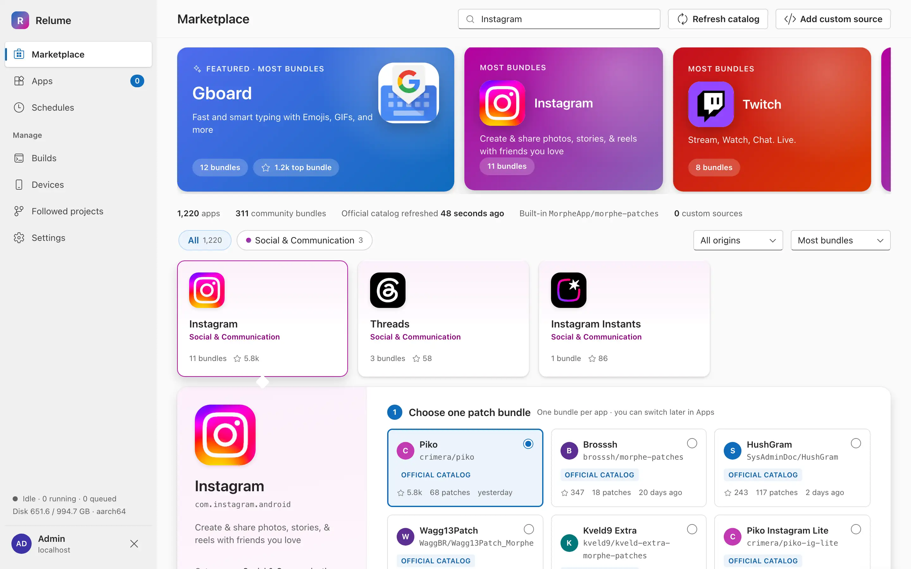

### 新增自訂來源

`Add custom source` 接受你信任的 GitHub 儲存庫：

1. 輸入 `GitHub repository URL`（`github.com/owner/repo`）。
2. 選擇 `Engine`：`Morphe patches`、`Xposed module, packaged with LSPatch` 或 `Xposed module, packaged with NPatch`。
3. Xposed 模組還要填 `Release asset regex`（哪個 release 檔案是模組 APK）與 `Target packages`（以逗號分隔的套件名稱，即此模組適用的應用程式）。
4. 按 `Add source`。它的應用程式會帶 `Custom` 標籤出現在列表中。

已新增的來源列在頁面底部的 `Custom sources`，每筆有刪除按鈕，刪除前會要求確認。

## Apps

`Apps` 列出所有已啟用的應用程式，以及你追蹤的專案（見 `Followed projects`）。上方五個方塊依狀態篩選：`All apps`、`Update available`、`Building`、`Failed`、`Needs URL`。標題列的說明文字顯示下次排程執行的時間。

每列顯示應用程式版本、套件（`Source`）與狀態標籤：`Up to date`、`Update available`、`Building`、`Queued`、`Not built`、`Failed` 或 `Needs URL`。建置失敗時會顯示原因與 `View log` 連結。

每列的按鈕（滑鼠移上去會顯示提示）：

| 按鈕 | 動作 |
|---|---|
| Check for updates | 檢查此應用程式是否有新的套件版本或新的應用程式版本。 |
| Rebuild / `Retry build` / `Rebuild with update` | 立即排入建置。 |
| Download APK | 選擇要下載的檔案（每個 ABI 變體一項）。 |
| App settings | 開啟設定抽屜。 |

標題列按鈕：`Check all for updates`（立即執行整套更新檢查）與 `Add from Marketplace`。

`Needs URL` 代表 Relume 找不到 APK 下載頁：開啟設定抽屜，在 `Download URLs` 填入網址。

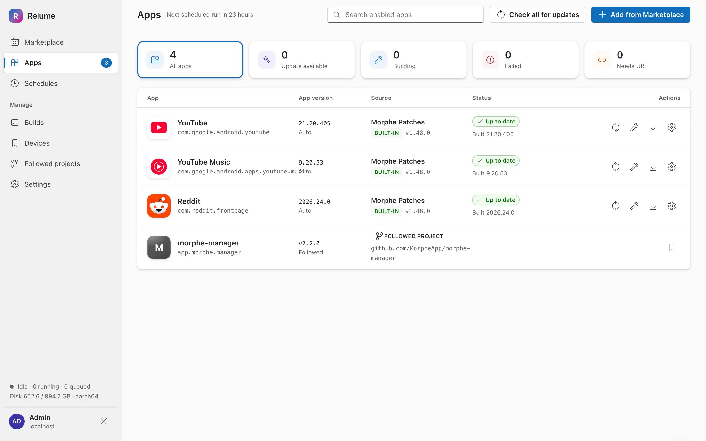

### 修改應用程式設定

齒輪按鈕會開啟設定抽屜。修改後按 `Save`，或按 `Save and rebuild` 儲存並排入建置。`Cancel` 會放棄修改。

| 區塊 | 可做的事 |
|---|---|
| `Enabled` 開關（最上方） | 關閉後停止更新與建置，設定與過去的建置會保留（儲存時會要求確認）。 |
| `Patch bundle` | 切換到其他套件。名稱相符的修補選擇會沿用。 |
| `Patches` | 與 Marketplace 相同的清單，附 `Filter patches` 與 `Reset to defaults`。 |
| `Xposed module` | 僅 LSPatch / NPatch 來源有：`Signature bypass level` 與 `Inject loader dex`。 |
| `Version` | `Auto`（套件支援的最新版）、`Pinned`（固定一個版本，在 `Pinned version` 選擇）或 `Latest`（APKMirror 上最新版，忽略相容性）。`Allow nearest version`：固定的版本在 APKMirror 上找不到時，改建最接近的版本。 |
| `ABI variants` | 要建置哪些 CPU 架構，至少要選一個。 |
| `Depends on Followed projects` | 勾選必須和此應用程式一起安裝在手機上的追蹤專案（例如搭配的 APK）。 |
| `Download URLs` | `APKMirror listing` 與 `APKPure`。有多個 APKMirror 頁面符合時，在這裡選正確的那個。 |
| `Display name` | 重新命名應用程式。`Refresh icon` 重新抓取圖示。 |

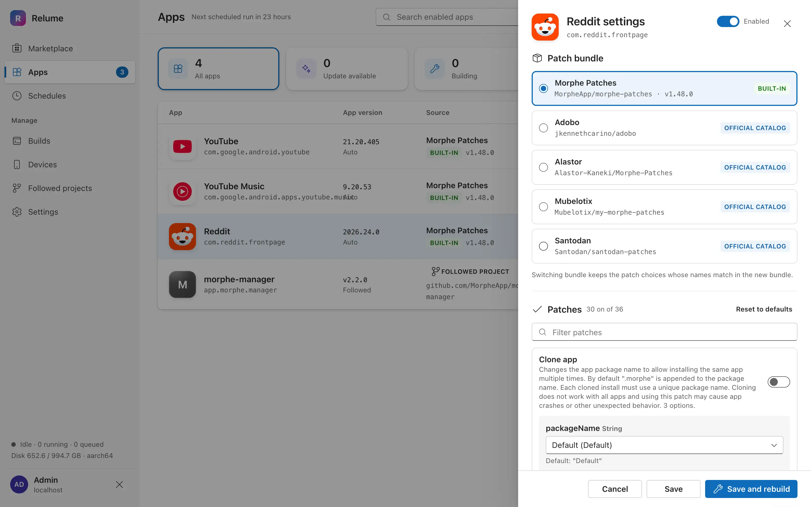

## Builds

上方面板顯示佇列與所選建置的記錄（執行中即時更新）。`Cancel` 停止執行中或排隊中的建置，箭頭按鈕把記錄下載成檔案。

下方 `History` 列出過去的執行。可用搜尋框（`Search app or bundle`）與標籤 `All`、`Succeeded`、`Failed`、`Cancelled` 篩選；`Load older` 載入更早的紀錄。每列有按鈕可查看記錄、下載成功建置的 APK、或重試失敗的建置。`Project pull` 類型是追蹤專案的檢查；`Update run` 是排程的更新檢查。

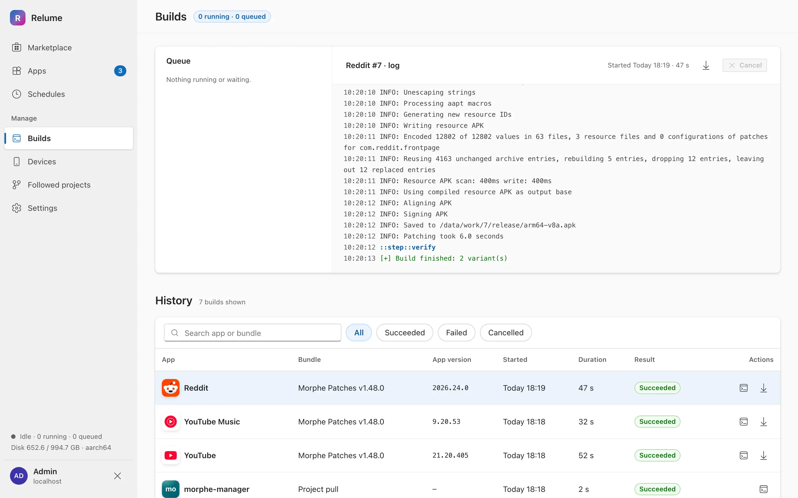

## Schedules

### 更新排程

大卡片 `Keep every enabled app updated` 決定 Relume 何時執行更新檢查。每次執行依序做：`Refresh catalog`、`Check chosen bundles`、`Check APKMirror`、`Rebuild what changed`（只重建有新套件或新版本的應用程式）與 `Notify`。

1. 選擇間隔：`1 h`、`3 h`、`6 h`、`12 h`、`24 h` 或 `Custom`。`Custom` 可選 `Repeat` = `Hourly`、`Daily` 或 `Weekly`，並設定時間（`At`）與星期（`On days`）。
2. 開啟 `Schedule on`。需要的話也開啟 `Notify on result`（通知管道在 `Settings` 設定）。
3. 按 `Save schedule`。

卡片顯示下次執行時間（使用伺服器的時區，標題列有顯示）與上次執行及其 `View log` 連結。`Run now` 立即開始一次執行，可在 `Builds` 追蹤。

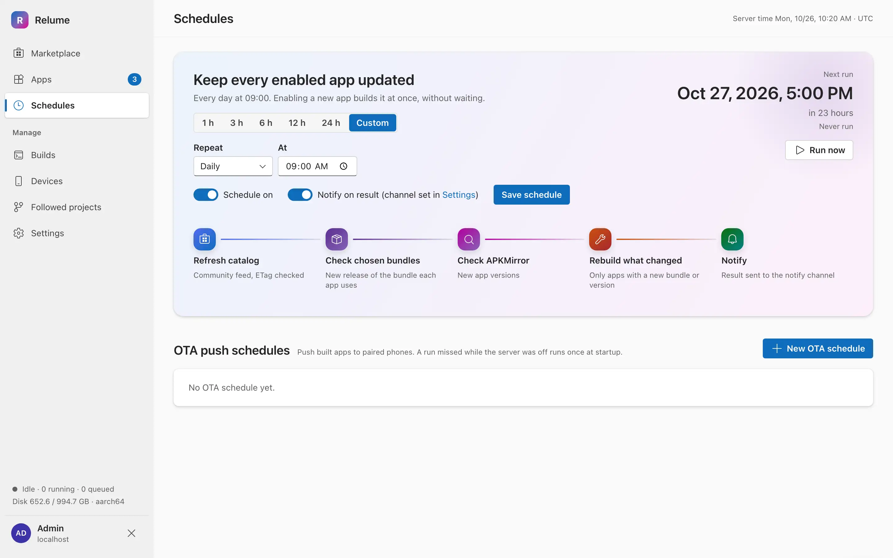

### OTA 推送排程

OTA 排程會在指定時間透過無線 ADB 把最新建置的應用程式推送到已配對的手機，不必開啟 Web UI。按 `New OTA schedule`，填寫 `Name`，選擇重複方式（欄位與上面的 `Custom` 相同）、`Retries for offline phones (60 s apart)`（0 到 5 次）、`Phones`（`All phones` 或指定手機），以及是否 `Notify on result`。每個排程都有開關，以及立即執行、編輯、刪除按鈕。伺服器關機期間錯過的排程，會在啟動時補跑一次。

## Devices

手機有兩種管理方式：**無線 ADB**（本頁），或安裝在手機上的 **Relume 同伴應用程式**（帶有 `Relume app` 標籤，由應用程式本身管理，見 Android 章節）。頁面頂端顯示網路模式：建議 Linux/NAS 用 `host`（以 mDNS 在區域網路自動發現手機），macOS 的 Docker Desktop 用 `bridge`，此時需自行輸入手機的 IP 與連接埠。找不到手機時，請使用 `Manual pairing`。

### 以無線 ADB 配對手機

1. 在手機上：設定 → 開發人員選項 → 開啟 `Wireless debugging`，再開啟 `Pair device with pairing code`。
2. 手機會以 `Pairing mode` 標籤出現在 `Discovered on network`。按 `Pair`，輸入 6 位數配對碼，再按 `Pair`。
   若沒有被發現，改用 `Manual pairing`：填 `Phone IP`、`Pairing port`、`Pairing code` 的六個數字，必要時填 `Connect port (optional)`，再按 `Pair & connect`。
3. 手機會出現在 `Paired devices`。點選名稱可重新命名。

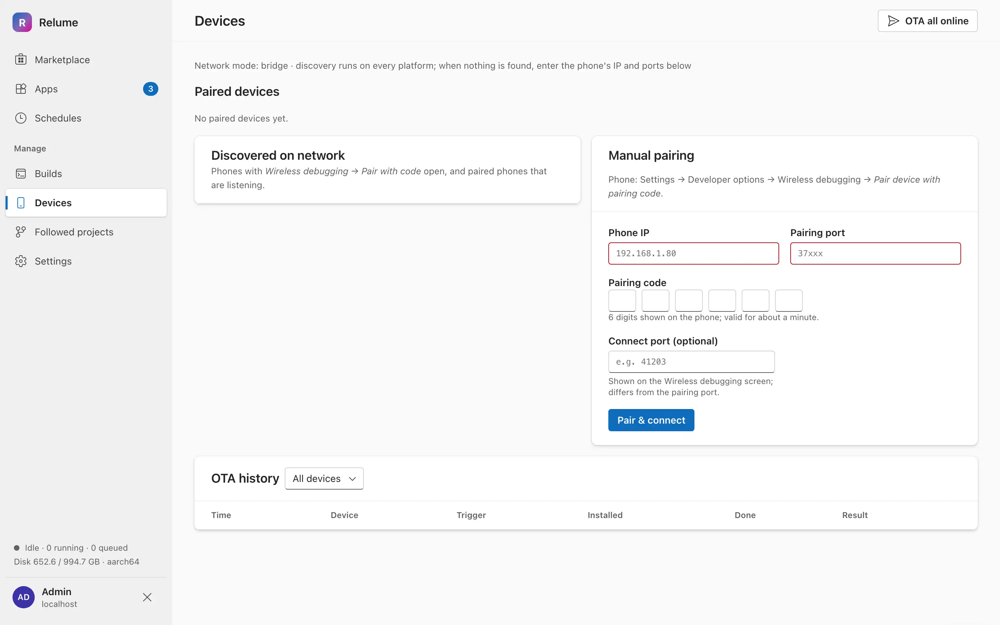

### 在手機上安裝與更新應用程式

每張已配對手機的卡片會列出指派給它的應用程式，以及已安裝與可用的版本。

1. 按 `Edit apps…`，勾選這支手機要接收的已啟用應用程式（與追蹤專案），再按 `Save`。
2. `OTA now · N pending` 會安裝該手機上所有過期的項目。標題列的 `OTA all online` 則對所有在線手機執行。
3. 開啟 `Install after build`，每次建置完成後自動安裝。
4. 手機離線：在手機上開啟 `Wireless debugging`，再按 `Reconnect`（連接埠有變動時會詢問新的連接埠）。
5. 安裝因簽章不符而失敗時，頁面提供 `Uninstall & retry`（應用程式資料會遺失）；版本降級時提供 `Install with downgrade`。
6. `Unpair` 移除手機（也要在手機的 Wireless debugging 下點 Forget）。

頁面底部的 `OTA history` 記錄每一次安裝的時間、觸發方式、安裝版本與結果，可依裝置篩選。

## Followed projects

追蹤在 release 中發佈成品 APK 的 GitHub 專案（例如某個修補管理程式）。Relume 會下載新的 release、驗證簽章金鑰，並可推送到手機。這些專案也會以 `Followed project` 出現在 `Apps`，可直接從那裡安裝。

1. 按 `Follow project`。
2. 輸入 `GitHub repository URL`（也可只輸入 `owner/repo`），按 `Fetch release`。若已在 `Settings` 儲存 token，私有儲存庫也可使用。
3. 在 `Asset file` 勾選要追蹤的 APK 檔。`Asset regex` 由你的勾選推導而來，可自行編輯：之後的 release 必須符合它，否則檢查會回報錯誤。Relume 會挑選符合手機 CPU 的 APK，否則用 universal 版本。
4. 選擇 `Channel`（`Stable` 或 `Pre-release`）、選填的 `Display name`、`Auto-push`（下載完成後立刻安裝到已指派的手機；簽章者改變時會自動暫停），以及要指派的手機。
5. 按 `Follow project`。

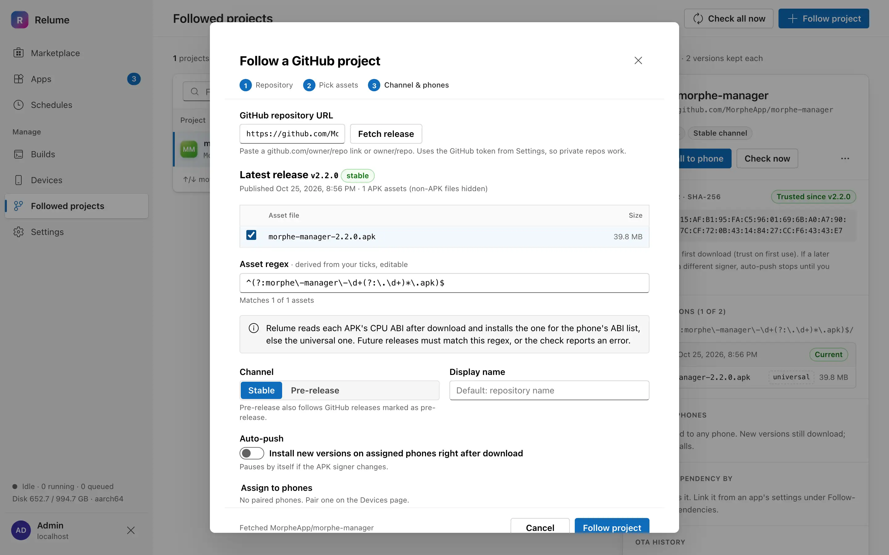

在清單中選取專案會開啟詳細窗格：`Install to phone`、`Check now`、簽章指紋、保留的版本（每個專案 2 個）、已指派的手機、OTA 歷史。`⋯` 選單內有 `Edit assets, regex & channel`、`Assign phones` 與 `Unfollow`（會刪除已下載的 APK；有應用程式依賴它時無法使用）。標題列的 `Check all now` 會檢查所有專案。篩選：`All`、`Needs attention`、`Dependencies`。

若某個 release 的簽章憑證與第一次不同，它會被隔離：自動推送、排程 OTA 與安裝都會停止，直到你開啟 `Review & confirm signer…` 並按 `Trust new signer`。Android 也不允許在簽章不同的應用程式上直接更新，所以手機必須先解除安裝舊的應用程式。

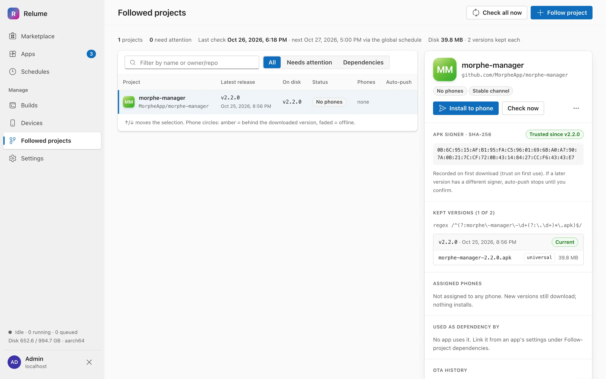

## Settings

- **Notifications。** 開啟 `Enabled`，選一個管道（`Telegram`：`Bot token` + `Chat ID`；`Discord`：`Webhook URL`；`ntfy`：`Server` + `Topic`），並在 `Notify on` 選擇事件：`New upstream patches`、`Build succeeded`、`Build failed`、`OTA finished`、`Project signer changed`、`Device went offline`。`Send test` 測試管道，`Save` 儲存。機密欄位只能寫入，顯示時會遮蔽。
- **Artifacts。** `Keep per item`（每個應用程式保留幾個 APK 版本）、`Job history count`、`Base URL`（連結使用的位址，例如 `http://nas.local:47000`）與 `Disk` 用量。`Clean up` 會刪除未啟用應用程式的建置與用不到的下載快取。
- **GitHub token。** 把 GitHub API 的上限從每小時 60 次提高，也讓私有的追蹤儲存庫可用。貼上 token 後按 `Save`；`Remove` 刪除；`Re-check` 顯示剩餘的額度。這裡儲存的 token 優先於選用的掛載機密檔，且不會再次顯示。
- **Phones with the Relume app。** 已登入的同伴應用程式裝置。撤銷（Revoke）會讓該手機登出，其裝置列與歷史仍保留。
- **Change password。** `Current password`、`New password`（至少 10 個字元）、`Confirm new password`，然後按 `Update password`。

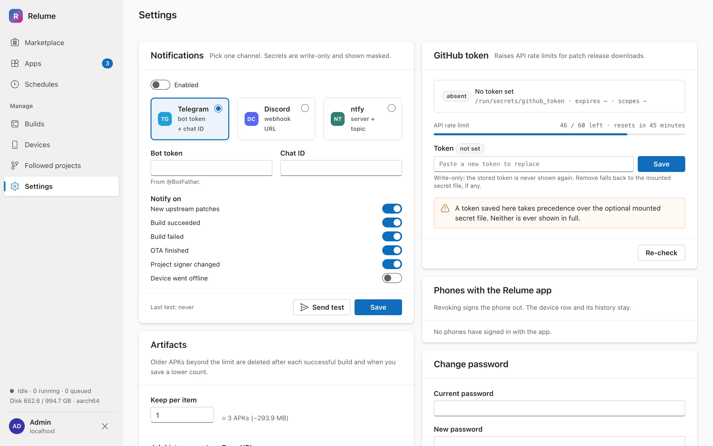

## Android 配套應用程式

配套應用程式（`android/`，Kotlin + Compose）會把 Relume 建置好的 APK **直接安裝在手機上，不需要 ADB，也不需要 root**。它用管理員帳號登入你的 Relume 伺服器、取得每支手機專屬的 token、下載建置好的 APK、驗證 SHA-256 與簽章者，再交給 Android 的套件安裝程式。它也會回報手機上已有哪些應用程式，讓 Relume 能顯示每個應用程式的「Installed」或「Phone has …」。

啟用應用程式與觸發建置，可以在網頁介面或應用程式內進行。應用程式的主要工作是在這支手機上 **Install（安裝）** 與 **Update（更新）**。

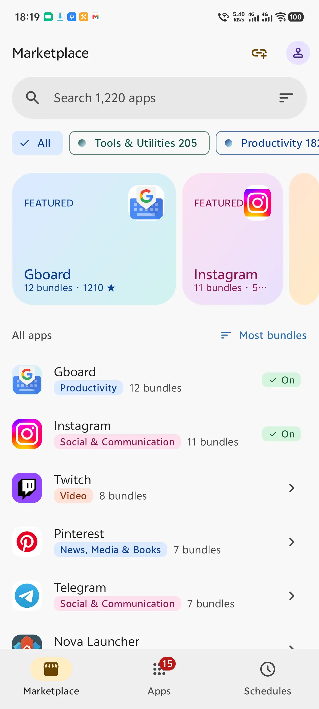
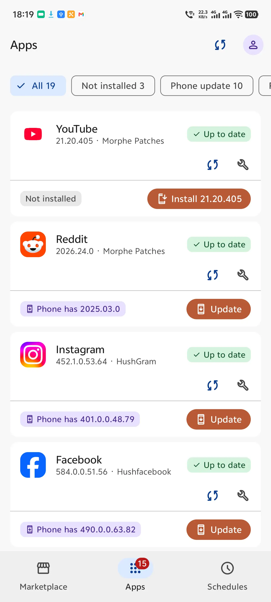
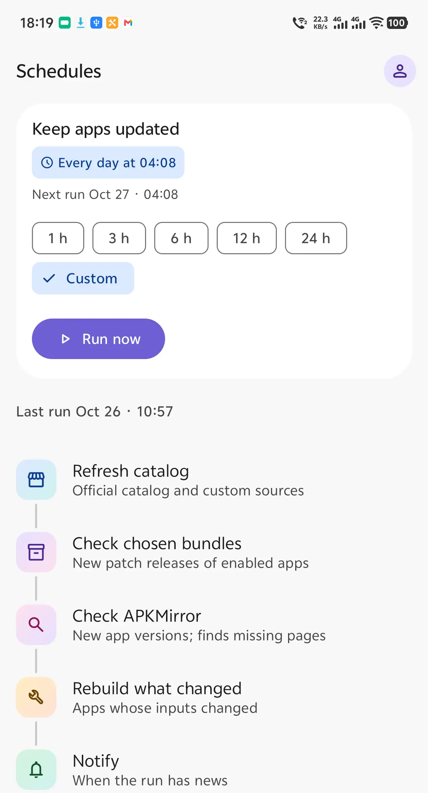

### 取得應用程式

1. 開啟本儲存庫的 GitHub **Releases** 頁面，選最新、標籤為 `companion-vX.Y.Z` 的版本。
2. 下載 `relume-companion.apk` 並在手機上開啟（需要 Android 10 / API 29 以上）。
3. 若 Android 詢問，請允許瀏覽器或檔案管理員安裝未知來源的應用程式。

只有推送 `companion-vX.Y.Z` 標籤時，CI 才會建置並發佈應用程式。應用程式不會自行更新：要更新配套應用程式，請從 Releases 下載較新的 `relume-companion.apk`，直接覆蓋安裝。目前版本顯示在 Settings 的 `App version`。

### 第一次啟動：連線到伺服器

1. 開啟 Relume，`Connect to Relume` 畫面需要三個欄位：
   - `Server URL`：Relume 網頁介面的位址，例如 `https://relume.example.com`。建議使用 `https://`，可搭配 Tailscale 或反向代理。`http://` 僅接受私有位址（區域網路、localhost），公開位址必須用 `https://`。網址不可含路徑、查詢字串或使用者名稱。
   - `Username` 與 `Password`：Relume 管理員帳號。
2. 點 `Sign in`。應用程式會先檢查伺服器，再註冊這支手機並儲存每支手機專屬的 token（不是你的密碼）。
3. 若伺服器上已有這支手機的 ADB 裝置紀錄，應用程式會詢問是否為該裝置。點選該裝置可保留它的應用程式指派；否則點 `No, register as a new device`。
4. Android 13 以上會詢問通知權限，請允許以收到安裝通知。

token 隨時可以在伺服器端撤銷；撤銷後應用程式會要求重新登入。

### 分頁

底部列有三個分頁：`Marketplace`、`Apps`、`Schedules`。右上角圓形的帳號按鈕會開啟 Settings。

#### Apps

登入後的預設分頁。每個已啟用的應用程式是一張卡片，顯示版本與修補套件組（patch bundle）、建置狀態標籤，以及手機列。分頁上的徽章數字是已啟用的應用程式數量。

- **篩選**：`All`、`Not installed`、`Phone update`、`Failed`、`Needs URL`，各附數量。下拉可重新整理。
- **安裝與更新**：手機列顯示 `Not installed`、`Installed <版本>` 或 `Phone has <版本>`。點 `Install <版本>` 或 `Update` 開始安裝。`Install` 畫面會顯示每個應用程式依序經過 `Download`、`Verify sha256 and signer`、`System install`。`Cancel` 中止，`Done` 關閉。
- **確認**：應用程式第一次安裝，或原本由其他安裝程式安裝時，Android 會要求確認一次。請在 `Install` 畫面（或通知）點 `Confirm`，再接受 Android 對話框。由 Relume 自己安裝的應用程式，之後的更新通常不需要確認。
- **相依**：若某個應用程式需要另一個，對話框會依順序列出，點 `Install all`。
- **每個應用程式的按鈕**：同步圖示檢查該應用程式有無更新，扳手圖示重新建置（失敗後為 `Retry … build`）。`Live log` 或 `Log` 開啟建置日誌。點卡片本身會開啟該應用程式的設定（套件組、修補、版本模式、ABI 變體、下載網址、`Save` 或 `Save & rebuild`）。
- **Needs URL**：APKMirror 找不到唯一頁面時，卡片會出現 `Add URL`（貼上 APKMirror 清單網址後 `Save`）或 `Pick one`（選出正確頁面後 `Use this page`）。
- **追蹤的應用程式（Followed）**：Followed 專案的應用程式以標示 `Followed project` 的卡片出現，只有 `Install` 或 `Update`。
- 頂端列的同步圖示（`Check all apps for updates`）會啟動與 Schedules 分頁 `Run now` 相同的更新執行。

#### Marketplace

瀏覽伺服器載入的目錄。

1. 搜尋（`Search … apps`）、用分類標籤篩選，或用排序按鈕（`Most bundles`、`Most stars`、`Recently updated`、`Name A–Z`；`All origins`、`Official catalog`、`Built-in`、`Custom`）。
2. 點選應用程式，在 `Choose one bundle` 下選一個套件組。可逐一開關各個修補，`Reset` 還原預設值。
3. 點 `Next: download source`。可選擇貼上 `APKMirror listing URL (optional)` 或 `APKPure URL (optional)`。
4. 點 `Enable and build`。Relume 立刻建置，並依全域排程持續更新。之後應用程式會在 Apps 分頁開啟該應用程式的設定。已啟用的應用程式顯示 `On`。

頂端列的連結按鈕（`Add custom source`）可用 `GitHub repository URL` 新增社群目錄。lspatch 與 npatch 引擎另外需要 `Asset regex` 與 `Target packages (comma separated)`。清單為空時，點 `Refresh catalog`。

#### Schedules

- `Keep apps updated`：伺服器多久檢查一次新的修補版本與應用程式版本，並重新建置有變動的項目。可選 `1 h`、`3 h`、`6 h`、`12 h`、`24 h` 或 `Custom`（每小時、每天或每週）。`Run now` 立即執行。下方顯示一次執行的各步驟與上次結果（`View log`）。若排程為關閉，畫面會註明，並指向網頁的 Schedules 頁面。
- `OTA push`：定時把新建置推送到 ADB 手機。用 `OTA schedule` 建立。透過配套應用程式安裝的手機不能當目標；ADB 手機請在網頁 Devices 頁面配對。

### 設定（Settings）

點任一分頁右上角的帳號按鈕。

| 區段 | 用途 |
|---|---|
| `Server` | `Server URL`（儲存新位址會讓這支手機登出）與 `Connection`（含伺服器版本）。 |
| `Account` | `Sign out and forget token`。token 本身請在伺服器端撤銷。 |
| `Background` | `Check for new builds`：`Off`、`1 h`、`6 h` 或 `24 h`。手機在背景檢查並開始安裝新建置。`Notifications` 顯示是否允許通知（`Allow`），`Last check` 顯示上次結果。 |
| `Storage` | `Clean up` 在確認對話框後，刪除伺服器上未啟用應用程式的建置與用不到的下載快取。 |
| `This device` | 伺服器記錄的這支手機名稱、型號與 Android 版本。 |
| `About` | `App version`。 |

背景安裝遵循與手動安裝相同的規則。需要 Android 確認時會收到通知（`Tap to confirm install of …`），並有一則摘要通知說明安裝了幾個應用程式。

### 疑難排解

| 症狀 | 處理方式 |
|---|---|
| 登入時出現 `Can't reach <url>`，或 `Request failed` 橫幅 | 檢查位址與連接埠、手機是否連得到伺服器（同一區域網路、Tailscale，或以 `https://` 連反向代理）、容器堆疊是否在執行，然後點 `Retry`。Settings 儲存新的 `Server URL` 前會先以 `/api/health` 檢查。 |
| `Sign-in failed` | 使用網頁介面的 Relume 管理員帳號與密碼。 |
| `use https:// for public addresses` | `http://` 只適用私有主機。請在前面加上有 TLS 的反向代理，或改用私有位址。 |
| `Allow installs from Relume` 對話框 | 在你允許 Relume 於「Install unknown apps」（安裝未知應用程式）之前，Android 會擋下安裝。點 `Open settings` 開啟權限，回到 Relume 再重新安裝。 |
| `Signature doesn't match` 或 `A newer version is installed` | 手機上的應用程式簽章不同或版本比建置新，Android 無法原地更新。請用 `Uninstall and install…` 並勾選 `I understand, uninstall first`。**這會刪除該應用程式在手機上的資料。** |
| `Signing key changed` | 伺服器上某應用程式的簽章金鑰改變了。只有確定是你預期的變更時才點 `Accept key`。 |
| 安裝停在 `Needs your confirmation` | 點 `Confirm`，再接受 Android 系統對話框。 |
| `The plan changed on the server` | 沒有安裝任何東西。返回後點 `Refresh` 再重新開始。 |
| 修補過的 YouTube、YouTube Music 或 Google Photos | 這些應用程式需要在手機上安裝 [MicroG RE](https://github.com/MorpheApp/MicroG-RE)。 |

## 開發

- 測試：`python3 scripts/test.py [--legs python,shell,android]`（僅限 macOS 與 Linux）。Linux 閘門（伺服器的實際平台）：

  ```sh
  docker build -f local/Dockerfile --target app -t relume-gate . && docker run --rm -v "$PWD:/repo" -w /repo relume-gate env -u RELUME_VERSION python3 scripts/test.py --legs python,shell
  ```

  Android 測試（需要 Android SDK）：`ANDROID_HOME=<sdk> python3 scripts/test.py --legs android`。
- 伴侶應用程式以推送 tag `companion-vX.Y.Z` 發佈：`Android` workflow 會建置並把 `relume-companion.apk` 發佈為本儲存庫的 GitHub release。
- 映像檔以 `python3 scripts/release.py <version>` 發佈到 Docker Hub。
- 更多：常見問題見 [docs/Frequently Asked Questions.md](docs/Frequently%20Asked%20Questions.md)。

## 授權

GPL-3.0，見 [LICENSE](LICENSE)。修補後的應用程式屬於原作者，請支持他們。

Relume 建立在 [FiorenMas/Revanced-And-Revanced-Extended-Non-Root](https://github.com/FiorenMas/Revanced-And-Revanced-Extended-Non-Root) 之上。

---

### ⚠️ 本儲存庫使用的函式庫與資源:

| 專案 | 作者 | 用途 | 授權 |
|---|---|---|---|
| [Morphe Patches](https://github.com/MorpheApp/morphe-patches) | MorpheApp | 內建修補包 | [GPL-3.0](https://github.com/MorpheApp/morphe-patches/blob/main/LICENSE) |
| [Morphe Desktop](https://github.com/MorpheApp/morphe-desktop) | MorpheApp | Morphe 修補包的修補 CLI | [GPL-3.0](https://github.com/MorpheApp/morphe-desktop/blob/main/LICENSE) |
| [LSPatch](https://github.com/JingMatrix/LSPatch) | JingMatrix | 嵌入模組(lspatch 引擎) | [GPL-3.0](https://github.com/JingMatrix/LSPatch/blob/master/LICENSE) |
| [NPatch](https://github.com/7723mod/NPatch) | 7723mod | 嵌入模組(npatch 引擎) | [GPL-3.0](https://github.com/7723mod/NPatch/blob/dev/LICENSE) |
| [APKEditor](https://github.com/REAndroid/APKEditor) | REAndroid | 讀取 APK 的套件名稱、版本與圖示 | [Apache-2.0](https://github.com/REAndroid/APKEditor/blob/master/LICENSE) |
| [pup](https://github.com/ericchiang/pup) | ericchiang | 解析 APKMirror 網頁 HTML | [MIT](https://github.com/ericchiang/pup/blob/master/LICENSE) |
| [FlareSolverr](https://github.com/FlareSolverr/FlareSolverr) | FlareSolverr | Cloudflare 驗證解題服務 | [MIT](https://github.com/FlareSolverr/FlareSolverr/blob/master/LICENSE) |
| [CloudflareBypassForScraping](https://github.com/sarperavci/CloudflareBypassForScraping) | sarperavci | APKMirror 解題器使用的瀏覽器映像 | [MIT](https://github.com/sarperavci/CloudflareBypassForScraping/blob/main/LICENSE) |
